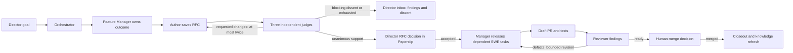

# Ralph v4.1 — How the engineering organization works

**Design draft for Director and Council review · 19 November 2026.** This revises [the v4.0 specification](ralph_v4.pdf). It describes the intended system; §11 identifies what has actually been demonstrated. It does not authorize a deployment, a repository merge, an external message, or retention of private conversations.

## 1. The promise to the Director

Give Ralph a goal, not a graph of tickets. For a feature, success means that the relevant manager has brought you a tested draft PR with review evidence. For a diagnostic question, success may be an answer with sources and no code change. You should be able to open Paperclip at any time and see who owns the outcome, what has happened, what is blocked, and the next decision that genuinely needs you.

**Paperclip is the control plane.** It records goals, projects, reporting lines, issues, assignees, dependencies, artifacts, human decisions, budgets and runs. Its adapters dispatch agents; its Routines schedule recurring work. Agents interpret requests and make in-policy decisions. Git stores code and canonical documents. A successful process exit is evidence of execution, not evidence of delivery.

**Ownership rule:** One reporting manager per operating agent. One outcome owner per request. One assignee per task. The Orchestrator may assign anyone in the organization; the outcome owner may delegate within the request. Neither assignment nor a Council verdict grants credentials, changes permissions, or waives a human gate.

## 2. Organization: reporting lines versus task ownership

```text
Director
├── Orchestrator (Chief of Staff)
│   ├── Feature Workflow Manager
│   ├── Review Workflow Manager
│   ├── Project Tech Lead(s), when justified
│   ├── Author
│   ├── SWE seat(s), scoped to product/repository
│   ├── Reviewer
│   ├── SRE Ops
│   ├── Librarian
│   └── Council: Architecture, Security, Scope (administratively)
└── Comms
```

The chart is permanent; the issue tree changes with the work. Council can sit under the Orchestrator for provisioning, scheduling and cost accountability. Its judgments stay independent: the Orchestrator cannot choose a favorable result, write a judge's verdict, or resolve a Director confirmation.

| Role | Owns | Typical handoff or limit |
|---|---|---|
| Director | Goals, policy and consequential decisions | Approves initiative RFCs in Paperclip and decides whether to merge code on GitHub. Does not assign every specialist. |
| Orchestrator | Intake, classification, selection of an outcome owner, and reporting back | Matches a known workflow or composes an in-policy plan. Tracks the manager's outcome, not every internal step. Use the proven `hermes_local` path on the pinned pilot; v4.0's `hermes_gateway` did not forward the required run token there. |
| Feature Workflow Manager | Delivery of a feature or initiative | Selects mode, delegates RFC preparation, decomposes approved work, manages dependencies and revisions, and delivers the merge packet. Owns delivery, not RFC or merge approval. |
| Review Workflow Manager | An inbound review outcome | Chooses depth, assigns reviewers and isolated checks, and assembles findings against the exact PR head. Does not approve another agent's work. |
| Project Tech Lead | Persistent domain context: architecture, contracts, conventions, trade-offs | Advises a manager or owns a project investigation directly. Create a lead where domain ownership pays for itself; do not duplicate a full specialist team per repo. |
| Author | Drafts and revisions | Hermes writes a Paperclip document with assumptions and open questions. A draft in stdout is not a handoff. |
| SWE | Implementation in the assigned repo and issue worktree | Paperclip dispatches `opencode_local` to edit, test, push the authorized branch, and produce a draft PR. No merge authority. |
| Reviewer | Independent technical decision on the exact code commit | Checks the diff, RFC and tests, then records technical approval or requests changes in its assigned Paperclip code-review stage. Cannot review its own code, approve on GitHub, or merge. |
| SRE Ops | Diagnosis, bounded CI repairs, operational evidence | Uses OpenCode for code work. Does not deploy or alter production merely because a test failed. |
| Librarian | Findability and housekeeping in shared knowledge | Proposes docs changes; project owners remain accountable for technical correctness. |
| Comms | Gmail/Chat intake, triage, drafts and thread continuity | Reports to the Director. Hands engineering outcomes to the Orchestrator. Cannot authorize its own send. |

Use Hermes for coordination, drafting, critique and triage; use OpenCode for SWE/SRE execution. Seats are accountable roles in Paperclip, not transient model personas appearing only in terminal output. A supporting subagent may help a seat, but the seat remains responsible for its assigned artifact.

The Orchestrator can assign an existing tech lead directly. If a project needs a **new persistent seat**, the Orchestrator recommends its domain and scope; the Director authorizes provisioning and any new access. Do not create a lead simply because a new project exists.

## 3. How an ambiguous request moves

1. **Intake.** Record the request, source, known constraints and intended outcome. Link an existing project or create a goal when this is an initiative. Search existing work and approved knowledge before asking the Director to repeat information.
2. **Classify.** The Orchestrator selects a registered workflow when it fits, validates its inputs, and assigns an outcome owner. For a narrow factual question it can answer directly or assign one expert. A novel coding or non-coding request can use a task-specific plan; do not stretch a feature playbook over unrelated work.
3. **Resolve ambiguity proportionally.** The owner can choose reversible implementation details and record assumptions. Ask one focused question if authority, cost, recipient, contractual behavior, or the useful outcome depends on the answer. Unsupported or unauthorized actions are reported, not silently substituted.
4. **Delegate.** The manager creates linked issues with the goal/project, assignee, expected artifact, acceptance condition and real blockers. The assignee gets only the tools and data its role permits. Specialists report results or blockers to the owner.
5. **Verify and report.** Check the actual artifact: document revision, reviewed head, passing test, delivered answer or send receipt. A missing artifact leaves work incomplete even when the run succeeded. Resume the right issue or escalate after the bounded retry limit; do not secretly finish an agent's work from the host.

| Request | Normal owner and route | Director involvement |
|---|---|---|
| “Build a boolean flag service.” | Orchestrator → Feature Manager → Author → Council → approved build tasks → SWE → Reviewer | RFC decision, then merge decision. |
| “Why did flag reads get slower? Don't change code.” | Orchestrator → SRE or project lead → sourced diagnosis | Only if investigation needs new access or consequential action. No automatic RFC or PR. |
| Novel in-policy request with no matching workflow | Orchestrator proposes a concrete plan, Council reviews it, then an owner executes | Unanimous support permits the **plan** to proceed. Subsequent human-only actions remain gated. |
| “Review this coworker's PR.” | Review Manager → exact-head sandbox checks and Reviewer → dossier | Human submits any GitHub review. |

## 4. Initiative lifecycle and Council contract



The Feature Manager owns this graph. The diagram preserves the v4.0 initiative gates while moving internal delegation from the Chief of Staff to the manager. For multi-repo initiatives, create a child per deliverable and block only real dependencies (for example, a consumer waiting on a schema); independent changes can proceed in parallel.

**Council input:** same identified RFC, plan or diff revision and same rubric for all three judges. Use three independent model families. Architecture assesses boundaries, consistency and failure recovery; Security assesses authority, data exposure and external effects; Scope assesses fit, alternatives and unnecessary complexity. Each judge explains their support, requested changes, or dissent in an ordinary comment on their own task. A template may help, but no particular format or JSON document is required.

The manager reads the three attributed comments for the same revision. All three must clearly support the proposal before it advances; a missing or unclear conclusion is not approval, so ask that judge. Requested changes go to the Author, with at most two completed revision cycles. A blocking objection or unresolved changes go to the Director with the author's position and the dissent. Present a concise brief covering the proposal, reasons, and remaining risks. Keep independent runs and comments visible in Paperclip.

**Three different signals:** Council support qualifies an initiative for Director review. Director acceptance is the sign-off for publishing the named RFC bytes into Git-backed PARA; neither a Docs PR nor a Done status substitutes for it. **Native Paperclip Done** releases assigned dependent work when its blockers resolve. An additional exact-revision *execution* gate is optional, not a launch requirement. If the Director declines or asks for changes, the manager keeps the RFC open. None of these actions merges code.

A novel plan in §3 uses the **same judges, rubric and revision limit** as an initiative RFC. What differs is the next action: unanimous support releases an in-policy plan to its owner; unanimous support on an initiative RFC requests a Director decision. Ordinary investigations through an existing role or workflow do not become novel plans merely because the answer is unknown.

On the build issue, the Feature Manager links the accepted Paperclip revision or its approved Git commit. The Reviewer compares the implementation with that reference. This makes drift visible without adding a second sign-off or a custom execution lock.

## 5. Repositories, worktrees and OpenCode

**Reuse each existing clone on its execution host. Never clone per task.** A project registration records the GitHub repo, trusted local checkout path, base ref, parent directory for issue worktrees, and authorized SWE seat. For example: `OWNER/ralph-canary`, `~/code/ralph-canary`, `origin/main`, and a sibling worktree directory outside the personal checkout. Resolve paths on the execution host, not relative to the Paperclip web server.

At setup, verify the checkout, expected origin and base ref. Reuse a matching registration; report drift rather than resetting a branch, overwriting local edits or silently downloading a substitute clone. At assignment, fetch updates into the shared repo, create one linked worktree and branch for the issue using Paperclip execution workspaces, and start OpenCode there. Follow-up work on that issue resumes the same path and session. If the user supplies an existing worktree, use it only when explicitly assigned and not active for another issue.

A linked worktree shares Git objects, not all checked-out bytes. Five GB of history need not be downloaded again; five GB of tracked assets can still take significant space **per worktree**. Cap concurrent worktrees on heavy repos. Use sparse checkout only after the repo's build and tests pass with it. Remove clean worktrees after merge or explicit abandonment; leave dirty or unmerged work for its owner. Never clean up the Director's working checkout.

**Execution locality matters.** `opencode_local` means local to its execution environment. The pilot has demonstrated container-local isolated worktrees and same-session resume. It has not demonstrated native Paperclip dispatch against the Director's existing Mac clone. Verify native runner placement and filesystem access before choosing a bridge. Do not mount a personal home directory, personal GitHub identity or host Docker socket into the shared board container to make the test pass.

Configure explicit provider/model IDs and the intended OpenCode configuration and failovers on the seat; a runner's isolated home must not depend on accidental host settings. Deliver the MANIFEST and repo build/test commands as shared, role-scoped instructions. Use attributable identities, scoped connections and branch protection. Completion evidence is a tested head SHA, worktree/branch, test results and draft PR linked to the issue.

## 6. Shared knowledge, memory and the Librarian

| Question | Authority | Retention and use |
|---|---|---|
| What is this run doing? | Adapter context and isolated workspace | Ephemeral scratch, terminal output and intermediate files. Not canonical memory. |
| Who owns the work; what was decided on the board? | Paperclip issues, comments, runs, blockers, approvals and documents | Working state and decision evidence; retain links and approved records rather than copying every transcript. |
| How does this role do its job? | Shared MANIFEST, Paperclip shared skills and repo-scoped instructions | Procedural knowledge: grants, conventions, escalation rules and commands. Instructions describe controls; permissions enforce them. |
| What design or contract is authoritative? | Git-backed `org-docs`; qmd indexes approved snapshots | Versioned Markdown. qmd is a search layer, not a source of truth. Optional MkDocs renders the same docs. |
| What useful lesson or preference did we learn? | Optional Hindsight, scoped by company and access policy | Episodic recall, not policy or approval. Automatic retention stays off until selection, access and deletion boundaries are proven. |

**Global means discoverable within permission, not globally writable or universally readable.** Share canonical project material across managers and specialists using project permissions. A restricted document stays restricted through search results, snippets and memory recall. Handoffs carry the issue link, relevant approved docs and expected result; receiving agents should not reconstruct assignments from chat history.

`docs/1-projects/<slug>/` holds approved initiative RFCs, briefs and rollout plans. `2-areas/` holds living product contracts, runbooks and engineering policy. `3-resources/` holds ADRs, templates and reusable references. `4-archive/projects/` preserves finished projects and history. Keep credentials, drafts, raw inbox threads and transient logs out of the shared index and long-term memory.

After final merge, the owner verifies the delivered change, proposes any contract/runbook update and records significant trade-offs as an ADR. The Librarian's periodic Paperclip Routine (weekly by default) proposes link repairs, duplicate consolidation and archival. Use reviewed Git edits, then refresh qmd from the approved snapshot. Only publish the refreshed index after verification; retain the prior known-good snapshot if refresh fails. Librarian owns findability, not unilateral contract changes or deletion. Lexical search is sufficient for initial use; hybrid search adds embeddings/reranking when configured and verified.

## 7. Gmail and Chat: one front door, not one ticket per message

Authenticated Gmail Pub/Sub and Chat webhook ingress → thin bridge → idempotent Paperclip Routine → Comms. A Gmail notification is not the message: resolve mailbox history through authenticated Gmail access. Verify Google's ingress identity, restrict mailboxes/senders or spaces as appropriate, ignore self/bot loops, and treat text and attachments as untrusted. An allowlisted sender is not a Director. Store stable event and thread identifiers so a redelivery does not create duplicate work and a follow-up can update the existing issue.

| Incoming message | Comms action |
|---|---|
| FYI or routine notification | Ignore if irrelevant, otherwise attach a concise note and source link to existing work. |
| Question | Check approved docs/current issues and draft a sourced reply. Delegate an investigation through the Orchestrator only if needed. |
| New request or follow-up | Hand the outcome and constraints to the Orchestrator, or update the linked task. Do not select a build workflow just because the request came from Chat. |
| Decision, sensitive request or change of scope | Put context, options and any proposed reply in the Director's inbox. Do not act on a sender's claimed authority. |

Internal delegation does not require send approval. **External send is Ask First:** show recipients, channel/thread and exact content; require an addressed human confirmation. A changed recipient or edit needs fresh approval. The sending identity should be unavailable to the drafting agent. Associate a send receipt with the approved action; after an ambiguous delivery result, check the receipt/provider before retrying. No automatic forwarding of correspondence into Hindsight or public docs. A thin n8n bridge is optional; it is not a second scheduler or task board.

## 8. Routines, PRs and tool access

Paperclip owns recurring schedules: target three-minute inbound/outbound PR checks and weekly knowledge upkeep. An existing deterministic worker can query GitHub or run tests; it is not an SWE agent. Paperclip should dispatch it on the appropriate execution host. Inspect native adapters, execution environments and existing services before adding transport. A host timer, custom MCP scheduler or SSH launcher is not the production design. Enable each schedule only after one native scheduled invocation works and duplicate/overlapping ticks cannot repeat side effects.

**Outbound PRs:** correlate repo, PR, issue and current head. Ignore processed events and automated replies (including `<!-- agent-maintenance-reply -->`). Retry infrastructure CI failures without changing code. Resume the same SWE worktree for concrete code/test failures or review feedback. Re-review material changes. Limit repair loops to two attempts; repeated red CI, ambiguous feedback or changes to an approved contract go to the Director. On base drift preserve PR history and escalate under [decision 0006](https://github.com/Zhachory1/ralph/blob/v4-architecture/docs/decisions/0006-v4-base-drift-preserves-pr-history.md); do not silently force-push. Green checks and required human review produce a merge-ready notification, not a merge.

**Inbound reviews:** use read-only discovery for requested reviews. Key each audit by repo, PR and head. Run untrusted code in a disposable network-isolated sandbox without host secrets, using operator-chosen pinned images and checks. Recheck head before publishing. Keep stale evidence as superseded and audit the new head separately. Publish the test outcome, findings and PR link in Paperclip. Reconcile completed human reviews against the intended reviewer and audited commit even after the request disappears. A dossier is not a submitted GitHub review. Pending review staging under a personal identity stays deferred unless accountable pending-only access can be enforced.

**MCP gateway:** register shared upstream tools once, grant least-privilege tool profiles, and let compatible sessions connect to Paperclip's private gateway. A shared endpoint does not mean shared admin credentials, identical tools, or no per-session network connection. Use Allowed / Ask First / Off per role and action. Explicit Hermes and OpenCode gateway connectivity and direct allow/deny fixture calls have been demonstrated. Automatic adapter injection and a model-driven tool call through it remain to be verified. A working Hermes stdio qmd connector is useful evidence, not proof that the gateway already delivers qmd to every seat.

## 9. Deployment, permissions and recovery

Use authenticated private Paperclip with PostgreSQL 17, persistent board and filesystem state, private tailnet access for the Director, and pinned runtime images. Keep optional Hindsight, qmd, comms ingress and the docs renderer separately configurable. No production requirement for a Ralph-owned MCP server, parallel task database, or new PR lock service. Prefer Paperclip run identities, native idempotency keys, blocker relations, run records and execution workspaces.

Provision the org repeatably: reconcile the desired roster, reporting relationships, skills, budget policies, workspaces and Routine ownership. Do not duplicate seats, silently change an existing repo mapping or overwrite existing human configuration. Bring-up on an empty company and reconciliation on a populated company are different tests. Deactivation, secret rotation and production cutover are distinct operator actions.

The two-page MANIFEST separates autonomous actions from hard stops. Back it with scoped keys, per-action tool grants and protected branches. Never infer key scope from a company selector: board keys inherit the approving user's authority. Keep provider credentials out of agent environments where the approved relay/managed-connection pattern is used. An independent Reviewer can accept a specific code commit in Paperclip; a new head requires a new review. No agent approves its own work, impersonates the Director, sends externally without approval, changes protected contracts unilaterally, or deploys by default. GitHub approval and merge are separate human decisions.

Use a seat's native agent/run identity for its board work. Do not distribute an operator's board key to seats as a substitute. If a maintenance action requires a board credential, run it under an operator account limited to the intended company and verify denial outside that company. No email header, Chat sender name, or verified delivery from Google constitutes Director approval; resolve that decision only in the addressed Paperclip interaction.

Track company/project/seat cost, use 80% warnings and 100% hard stops, limit unattended runs and investigate unknown pricing before relying on a cap. A request/token limit is not a dollar cap. Check the ledger, actual notification delivery and refusal of the next chargeable run separately. Use run IDs, head SHAs, document IDs, costs and optional OpenTelemetry for diagnosis; do not log credentials or indiscriminately export prompts.

Back up the database **and** matching persistent state/configuration; protect signing material separately. Rehearse authenticated recovery and rollback on the target. Quiesce ingress and schedules for the switch, keep the prior routing available, verify a board login and one controlled task, and account for post-switch writes before reverting. Do not retire a legacy route until the replacement has passed and the Director has authorized cutover.

## 10. Acceptance: prove the organization, not only its parts

| Test | Pass evidence | What does not count |
|---|---|---|
| Ambiguous feature intake | Hand the Orchestrator the boolean-flag goal and supplied constraints. Board shows Orchestrator delegated the outcome to Feature Manager; **manager** created and assigned the Author task. | Operator pre-creates the specialist chain or assigns the Author. |
| Initiative review | Author saves an RFC on the issue; Review wakes three judges; verdicts and brief are visible. Demonstrate revise, cap/escalation and human acceptance before build. | RFC only in stdout, host-generated substitute, mock approval, or issue status presented as sign-off. |
| Native coding on an existing host repo | Director accepts; manager creates build work. Mac-side `git worktree list` shows the issue worktree for the existing clone. Same-path follow-up, unchanged personal checkout, tests and exact draft PR reach Reviewer. | Reclone, container-only clone passed off as Mac execution, successful exit without delivery. |
| Flexible diagnostic | A second request asks why behavior changed and forbids code edits. Orchestrator routes it to a specialist; answer cites evidence; no unnecessary RFC or PR. | Replaying the feature graph for every input. |
| Gateway-backed role access | On each adapter that will use a production grant, dispatch a seat to call a harmless allowed tool, then verify a seat without the grant cannot call it. Verify that its board identity cannot read or mutate outside its granted scope. | A connected client, a tool listing, an operator-token test, or an accepted configuration alone. |
| Permission and operational checks | A denied seat cannot use restricted tools; retry cannot double-send or re-audit a head; budget and recovery controls behave on the intended target. | Settings alone treated as enforcement; test-only helper credited as native live dispatch. |
| Knowledge and communications | Authorized agents find the new approved revision, not drafts or stale content; restricted seats do not. A real authenticated message is threaded, triaged, approved if sent, and delivered once. | Merely listing tools, indexing raw mail, or trusting normalized input as proof of Google authentication. |

**Flag evaluator as an acceptance workload, not part of Ralph:** one boolean flag and version per read; versioned history in Postgres, Redis cache-aside with 300-second TTL and Postgres fallback, simple authenticated admin editing, no traffic targeting. Deliver it in `ralph-canary` as a tested draft PR. Do not embed that product's database schema, UI or cache behavior into the orchestration platform.

## 11. Evidence and delivery order

The sandbox has demonstrated native Hermes → OpenCode delegation and issue-worktree resume. The flag trial itself did **not** prove the managerial flow: an operator assigned the Author; the Author produced text in its run log without saving the expected RFC. Treat that as a failed handoff, not an initiative completed. The six operating seats observed in the sandbox are not evidence that managers, Council or Librarian are provisioned and integrated.

| Deliverable | Existing evidence | Remaining proof |
|---|---|---|
| Private deployment and roster | [#261](https://github.com/Zhachory1/ralph/issues/261): Postgres overlay, initial seat provisioning, synthetic budget thresholds | Repeatable full org on an existing company, native Mac execution, live permissions, spend enforcement and alerts. |
| Initiative | [#262](https://github.com/Zhachory1/ralph/issues/262): isolated author/Council mechanics, native review documents and dependency release | Orchestrator → manager ownership, visible independent Council stage, approved Git publication, SWE → Reviewer handoff in one initiative. |
| PR work | [#263](https://github.com/Zhachory1/ralph/issues/263), [#264](https://github.com/Zhachory1/ralph/issues/264): bounded maintenance worker; serial discovery/audit/reconciliation available | Native scheduled dispatch, repo/PR linkage, unattended behavior and authorized activation. |
| Shared knowledge | [#265](https://github.com/Zhachory1/ralph/issues/265): approved snapshot refresh and direct connector tested | Scoped agent retrieval through gateway, Librarian upkeep, merge-driven archive/ADR; optional Hindsight retention policy. |
| Comms | [#266](https://github.com/Zhachory1/ralph/issues/266): normalized allowlisted events create deduplicated Routine runs | Authenticated live ingress, thread continuation, exact-content approval and send receipts. |
| Cutover | [#267](https://github.com/Zhachory1/ralph/issues/267): disposable backup, restore, application boot and rollback | Actual-target rehearsal, Director's switch decision, retirement of replaced routes. |

Start with startup reconciliation and the two intake tests, then deliver one native initiative on an existing host repo. Exercise routine-owned PR work and the knowledge gateway; bring comms online independently. Activate schedules and legacy cutover deliberately. [#243](https://github.com/Zhachory1/ralph/issues/243) is optional execution hardening, not a dependency for these milestones.

## 12. Source reconciliation and review request

| v4.0 source | v4.1 disposition |
|---|---|
| §§1–3, topology and org chart | Keep Paperclip as control plane. Add workflow owners, optional project leads and Librarian; distinguish reporting lines from task assignments. |
| §§4–5, Council and initiative | Keep three independent families, bounded revision and human gates. The Feature Manager owns internal delegation. Apply [#239](https://github.com/Zhachory1/ralph/issues/239) to novel in-policy plans, not to waive initiative approval. |
| §6, PRs | Keep exact-head sandboxing and human submission/merge. Prefer native Routine state and protected PR history over the PDF's custom tables, personal review writes and unconditional rebase recipe. |
| §7, memory | Keep four tiers, Hindsight and Git/qmd separation. Make retention opt-in, ownership explicit, and shared search permission-aware. |
| §§8–9, deployment and rollout | Keep private access, Postgres, budgets, bounded loops and recovery. Pin versions. Treat example Compose, service counts and week estimates as guidance, not installed capabilities. |

Companion references: [Ralph workflow definitions](https://github.com/Zhachory1/ralph/blob/v4-architecture/docs/workflows.md), [operations runbook](https://github.com/Zhachory1/ralph/blob/v4-architecture/docs/operations.md), [Council rubric](https://github.com/Zhachory1/ralph/blob/v4-architecture/profiles/council/rubric-v1.md).

**Council question:** Can an operator implement and test this design without inventing authority, a second control plane, or an unspecified handoff? Architecture should trace the feature and diagnostic paths through failure and recovery. Security should trace the grants for host repos, search, model calls and external sends. Scope should identify mandates that add work without changing an acceptance outcome. Record concrete findings against this exact document, distinguish recommendations from blockers, and preserve dissent. Council review is not Director sign-off.
