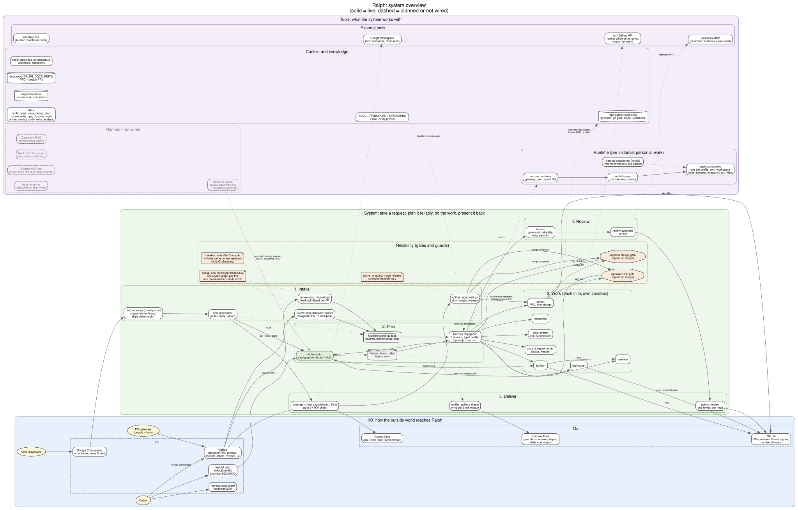
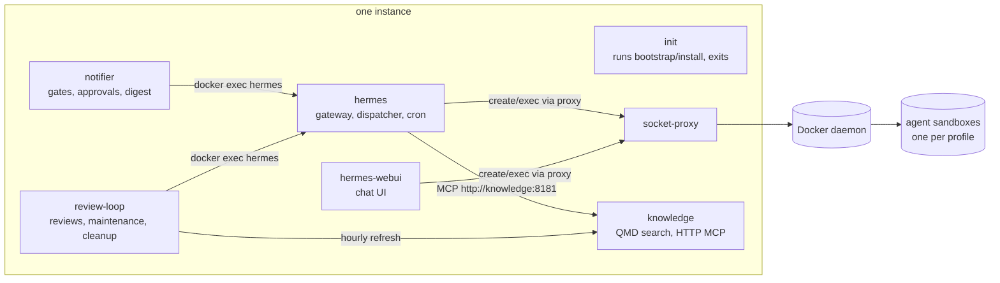

# Infrastructure

Where each part of Ralph runs, what it can touch, and how to check it is healthy. Workflows are in [workflows.md](workflows.md); day-to-day operations in [operations.md](operations.md).

## System overview



Three bands: **I/O** (how people and services reach Ralph and how it answers), **System** (intake → plan → work → review → deliver, with the gates and guards that keep it reliable), and **Tools** (runtime, context and knowledge, external tools, and what is planned but not wired). The same picture, one band at a time:

- [I/O](diagrams/io.svg): who reaches Ralph, through what, and how it answers.
- [System](diagrams/system-flow.svg): intake → plan → work → review → deliver, with the reliability band.
- [Tools](diagrams/tools.svg): runtime, context and knowledge, external tools, which profile gets what, and what is planned.

Sources are the `.dot` files in [`diagrams/`](diagrams/). Regenerate after a change with `for f in docs/diagrams/*.dot; do dot -Tsvg "$f" -o "${f%.dot}.svg"; dot -Tpng "$f" -o "${f%.dot}.png"; done`.

## Instances

One checkout runs several independent Ralphs. Each is a compose project named by `RALPH_INSTANCE`, with its own env file, containers, volumes, boards, ports and workspaces.

```bash
cd compose
docker compose --env-file .env ps                                   # personal
RALPH_ENV_FILE=.env.work docker compose --env-file .env.work ps      # work
```

| Setting | What it separates |
|---|---|
| `RALPH_INSTANCE` | compose project and container names (`<instance>-hermes-1`, ...) |
| `RALPH_ENV_FILE` | which env file the containers load |
| `RALPH_WORKSPACES` | the host folder mounted at `/workspaces` (repo cache, review evidence, chat inbox) |
| `RALPH_SANDBOX_ROOT` | the host folder for agent sandboxes, mounted at the same path inside |
| `RALPH_DOCS_REPO` | the docs repository: documents, memories, and what the knowledge service indexes (its own volume per instance) |
| `RALPH_DASHBOARD_PORT`, `RALPH_WEBUI_PORT` | localhost ports |

`.env.example` documents every setting. Env files are gitignored and never committed.

## Containers



| Container | Runs | Can touch |
|---|---|---|
| `socket-proxy` | Docker API filter | Containers, exec, images. Not volumes, not `info`. |
| `init` | `bootstrap/install`, then exits | Writes profiles, SOULs, configs and tokens into the hermes volume. Starts after `hermes` (it configures hermes through the CLI there); `hermes-webui` waits for it to finish. Run it by hand after a change. |
| `hermes` | Gateway, Kanban dispatcher, cron scheduler | The board database, every profile's home, the Docker API through the proxy. |
| `hermes-webui` | Chat UI on `127.0.0.1:$RALPH_WEBUI_PORT` | Same hermes home; runs profiles in-process, with commands in the sandbox. |
| `notifier` | `bootstrap/run-notifier`: approvals, gate alerts, morning digest | GitHub with `RALPH_GITHUB_TOKEN`, the board through `docker exec`, the Chat webhook. |
| `review-loop` | `bootstrap/run-review-loop`: review discovery and publishing, maintenance, sandbox cleanup, knowledge refresh | GitHub with `RALPH_GITHUB_TOKEN`, the board through `docker exec`, `/workspaces`. |
| `knowledge` | `qmd mcp --http` on `knowledge:8181`, not published to the host. On when `COMPOSE_PROFILES` includes `knowledge`. | Its own volume (`/var/lib/ralph-knowledge`: docs checkout, index, local models) and Ralph's `docs/`, read-only. CPU only, `mem_limit` 4g. |

**Agent sandboxes** are Docker containers that Hermes creates per profile (`terminal.backend: docker`, image `ghcr.io/zhachory1/ralph-sandbox`). Every agent command runs in one. A sandbox sees its own `/workspace` and home, plus only these extras:

| Mount (read-only) | Profiles |
|---|---|
| `/repo-cache` (the instance's clone cache) | author, builder, maintainer, researcher, default |
| `/workspaces/review-work` (staged review evidence) | the four lenses, review-synthesis |
| `/workspaces/chat-inbox` (staged chat evidence) | chat-maintainer |
| `$RALPH_SANDBOX_ROOT/.webui-attachments` (WebUI chat uploads, at the path the chat names) | default only. It copies what a task needs into the card; no other profile reads uploads (#128). |

The sandbox cannot see the host, the Docker socket, the board or another profile's files; `evals/test_sandbox_isolation.py` checks this against a live sandbox.

## Profiles

Every profile's SOUL starts with `profiles/PRINCIPLES.md` and `profiles/STANDARDS.md`, then its own `SOUL.md`. The WebUI `default` profile's own text is `profiles/DEFAULT_SOUL.md`, written to the global `SOUL.md`. The table in the [README](../README.md#profiles-exist-at-permission-boundaries) lists what each may change. Tools differ by role:

- **Kanban tools:** every general profile and the WebUI `default` profile. The lenses, review-synthesis, chat-maintainer, chat-summarizer and inbox-drafter do not have them, by design.
- **Knowledge (`mcp_servers.knowledge`: query, get, multi_get, status):** the general profiles and `default`, when the knowledge service runs. Not the lenses, review-synthesis, chat-maintainer, chat-summarizer or inbox-drafter.
- **Terminal:** every profile, so `gh` works ([0001](decisions/0001-every-profile-gets-repository-access.md)). `git` and `gh` run only in the terminal, never `execute_code` ([0003](decisions/0003-repository-credentials-only-in-the-terminal.md)).

## Credentials

| Credential | Lives in | Reaches |
|---|---|---|
| `RALPH_GITHUB_TOKEN` (review account) | instance `.env` | notifier, review-loop; read profiles when `RALPH_PROFILE_READ_TOKEN` is blank |
| `RALPH_PROFILE_READ_TOKEN` | instance `.env` | `GH_TOKEN` of every read profile and `default` ([0002](decisions/0002-personal-profiles-read-with-the-owner-token.md)) |
| `RALPH_MAINTAIN_TOKEN` (PR author) | instance `.env` | `GH_TOKEN` of author, builder, maintainer |
| `RALPH_BUILDKITE_TOKEN` | instance `.env` | `BUILDKITE_API_TOKEN` of builder and maintainer |
| Model provider keys | instance `.env` / hermes auth | hermes; never forwarded into a sandbox |
| Google Chat send token | host `~/.config/gws-cli/` | host LaunchAgent `chat-reply` only |
| Chat webhook (`RALPH_NOTIFY_URL`) | instance `.env` | notifier, overlay digest job |

A profile token lives in that profile's own `.env` (mode 600) and is forwarded into its sandbox by name (`terminal.docker_forward_env`), never on a command line.

## Scheduled work

| What | Where | Interval |
|---|---|---|
| Kanban dispatch | hermes gateway | continuous |
| Approvals, gate alerts | notifier | `RALPH_POLL_SECONDS` (900) |
| Morning digest | notifier | once a day after `RALPH_DIGEST_HOUR` |
| Review discovery, publish, maintenance | review-loop | `RALPH_REVIEW_POLL_SECONDS` (900); `run-review-loop --once` on demand |
| Sandbox cleanup | review-loop, `bootstrap/cleanup-sandboxes` | at most hourly |
| Knowledge refresh | review-loop, `bootstrap/refresh-knowledge` in the knowledge container | at most hourly |
| Overlay jobs (chat inbox, chat digest) | Hermes cron on `ralph-inbox-drafter` | per job (`hermes -p ralph-inbox-drafter cron list`) |
| Chat reply sender | host LaunchAgent `dev.ralph.chat-reply.<instance>` | every 60 s |

Cron jobs can also be created from the WebUI's Crons panel; pick the Ralph profile the job runs as. `hermes pause` stops cron and Kanban dispatch together.

## Knowledge

One QMD index per instance over two collections: `docs` (a checkout of `RALPH_DOCS_REPO`) and `ralph` (this repo's `docs/`). Agents search it through the MCP tools and cite what they used. They write memories as single files under `memory/` in the docs repo, directly on its default branch (PRINCIPLES, "Write down what lasts"). Install writes `RALPH_DOCS_REPO` and `RALPH_DOCS_PUBLIC` into every profile; a public docs repo (or one whose visibility cannot be read) gets the public-safety rule. Models (embeddinggemma-300M, qwen3-reranker-0.6b) run locally; there is no query-expansion model and no cloud call. Agents search with typed `searches` and `rerank: false` (PRINCIPLES), about a second per query. Re-ranking takes minutes on CPU (108–239 s measured), so it is only for the rare case where fast results look wrong. A plain-text `query` is never used: it loads the 1.3 GB expansion model.

## Private overlay

`RALPH_PRIVATE_SKILLS`, `RALPH_PRIVATE_JOBS` and `RALPH_PRIVATE_MCP` point at a private checkout (`rokt-it-ralph`) beside this one. Skills mount read-only at `/ralph/private-skills`; each job's `job.env` names its profile and options, and `bootstrap/install-overlay-jobs` copies its scripts into that profile. `RALPH_PRIVATE_MCP` is a folder holding `mcp.json`: each server's Hermes config, a required tool allowlist, and the profiles that get it (`default` is the WebUI chat). Install merges each server beside `knowledge` and lens-tools. Profiles not named never get it, and a server removed from the file is removed on the next `init` (#133). Nothing work-specific lives in this repo.

## Is what is live what is on `main`?

```bash
# scripts the loops run come straight from this checkout:
docker exec <instance>-review-loop-1 sha256sum /ralph/bootstrap/discover-reviews
sha256sum bootstrap/discover-reviews
# a profile's SOUL is PRINCIPLES + STANDARDS + SOUL:
{ cat profiles/PRINCIPLES.md; echo; cat profiles/STANDARDS.md; echo; cat profiles/builder/SOUL.md; } | sha256sum
docker exec <instance>-hermes-1 sha256sum /home/hermes/.hermes/profiles/ralph-builder/SOUL.md
```

After a merge that changes profiles or `bootstrap/install`, re-run `init` for each instance, from `compose/`: `RALPH_ENV_FILE=.env.<name> docker compose --env-file .env.<name> run --rm init`.
