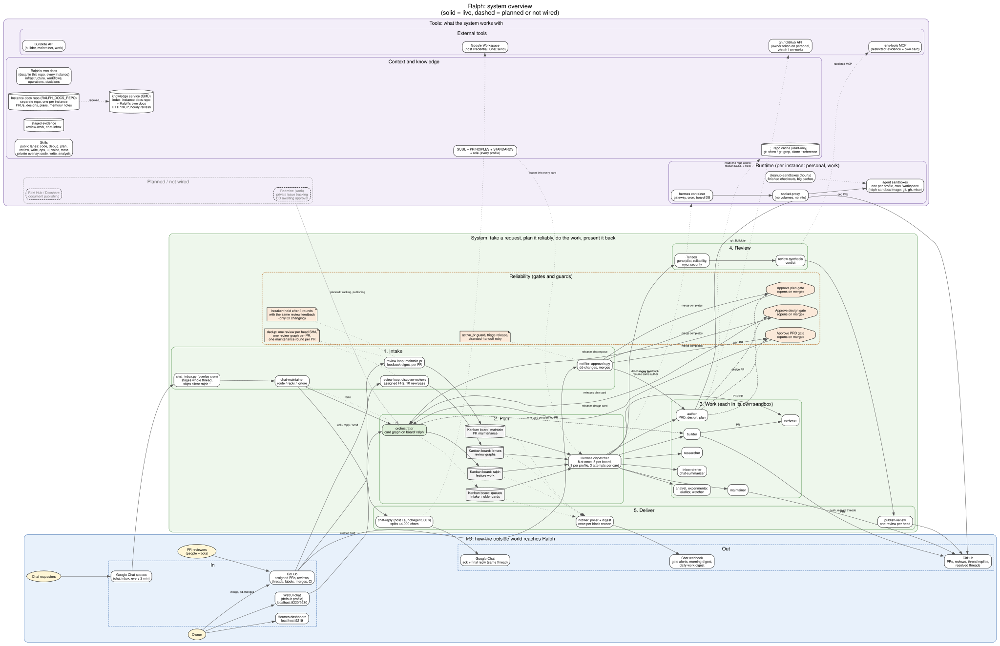
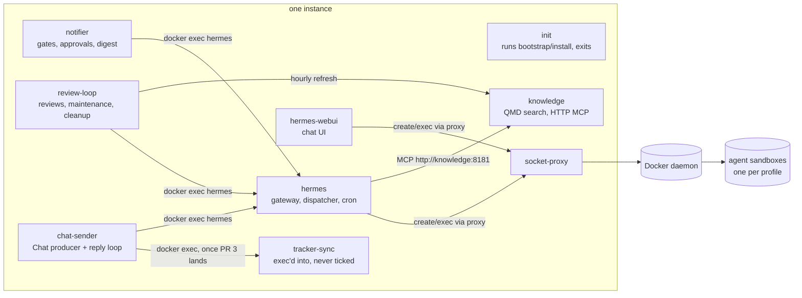

# Infrastructure

Where each part of Ralph runs, what it can touch, and how to check it is healthy. Workflows are in [workflows.md](workflows.md); day-to-day operations in [operations.md](operations.md).

## System overview



The standalone Paperclip canary (`compose/v4/paperclip-canary.yml`) combines pinned Paperclip and
Hermes images in one disposable container with embedded PostgreSQL. It has loopback only, no
published ports or host bind mounts, and no repository or provider credentials. Both adapters
execute inside the fixture. This setup does not isolate agents from the Paperclip server and is
not an authenticated deployment.

`compose/v4/paperclip-canary.Dockerfile` applies `compose/v4/paperclip-handoff.patch` to the
pinned 2026.1117.0 source before rebuilding the server, then ships the patched source, `dist`,
and `dist-runtime` in the same image used by both the canary and the private preview. The patch
is adapted from upstream Paperclip PR #18510
(https://github.com/paperclipai/paperclip/pull/18510, commit
4fe6a94b958c3a685608e9ce3a0aa5422b658f80): it makes the reviewer/execution handoff wake exactly
once and discards it on a stale review stage, assignment, or cancellation instead of resuming a
handoff that no longer matches the current assignment. It does not change any approval gate or
add a new scheduler; the existing heartbeat scheduler still owns dispatch. Retry deduplication
also matches the original agent, so a different agent's handoff is not mistaken for its retry.
The local patch also treats pending, wake-enabled interactions and unfinished visible blockers as
durable review waits, and rechecks both before escalation. Resolved interactions, cards without
a wake, and completed or hidden blockers do not suppress recovery.

The standalone private preview (`compose/v4/paperclip-private.yml`) runs only the combined
Paperclip/Hermes image with authenticated access, a loopback-only published port, a dedicated
Compose bridge, and a named state volume. The bridge permits outbound traffic. It starts
no Ralph-owned MCP server and does not start or replace any legacy stack. See the
[bootstrap runbook](operations.md#bootstrap-a-fresh-private-paperclip-preview).

Use [roster reconciliation](operations.md#provision-the-paperclip-organization) after
authenticated startup to add missing v4.1 seats to a populated company.

The [PostgreSQL deployment](operations.md#prepare-a-private-paperclip-target) layers
`compose/v4/paperclip-postgres.yml` over that file. PostgreSQL 17 has its own named
volume and internal network with no published port. Paperclip keeps its loopback
port; Tailscale Serve can expose it privately without opening a public listener.

The localhost pilot launcher runs an OpenRouter relay on the preview's dedicated Docker
bridge with no published ports or mounts. It passes the provider key on stdin to the
non-root relay, not to Paperclip or the agents. The relay limits requests and lifetime,
but it does not enforce per-agent access or isolate agents from the Paperclip server.
Paperclip board keys inherit the approving account's permissions, not the company selected
in the CLI prompt. Use a sandbox-only operator account to restrict the key's authority.
An OpenCode seat can receive `GH_TOKEN` through its configured Paperclip secret reference.
That token's issuing account and scopes determine its GitHub authority.

The separate RFC canary uses the same built image in authenticated mode with disposable
Director and operator accounts. It runs on container loopback only, with no live data,
credentials, or published ports. The database and Git repository are removed with the container.

The manual Routine worker runs on the host against a localhost Paperclip board and a dedicated
Git clone. Its canary uses the authenticated fixture and a temporary local Git repository
without GitHub credentials. The existing audit runner puts test and lint in separate
network-disabled containers with no bind mounts.

The opt-in Chat ingress bridge listens on host loopback and verifies Google Chat's OIDC
token before invoking the existing Routine intake worker. It holds a Paperclip board key;
the issuing account's permissions bound that key. External HTTPS routing is not provisioned.

The v4 qmd canary uses a disposable config and index scoped to a clean Git worktree
pinned to the approved commit. It does not start an MCP server or connect Hindsight.

The optional v4 QMD service in `compose/v4/paperclip-knowledge.yml` joins an existing
Paperclip network, keeps its index in a separate named volume, and publishes no host port.
Network access is not a per-seat authorization boundary.

The v4 qmd gateway canary (`compose/v4/bootstrap-qmd-gateway.sh`,
`compose/v4/test/paperclip-qmd-gateway-canary.py`) grants a disposable `hermes_local`
Paperclip seat that same approved-only index through Hermes' own native `hermes mcp add`
connector, run with `docker exec` against the same disposable, network-disabled canary
container `paperclip-canary.py` uses -- not the Ralph knowledge container, not a separate
Hermes container or profile. No live Paperclip target, model-driven run, or Hindsight.

The v4 Council pilot has a standalone panel in `compose/v4/council-v1.mjs` and a judge launcher
in `compose/v4/council-judge.mjs`; neither is connected to board routing.
Each invocation uses a disposable, non-root, read-only Docker container with no host mounts or
repository/board credentials; it receives the model-provider key. Bridge-network egress is not
restricted to the provider. The pinned Hermes invocation exposes no tools in synthetic model
requests; rerun the offline Docker fixture before changing its image or tool configuration.
Docker-daemon administrators can inspect the container's provider key while it runs.

The standalone Council service in `coding-harness/council-mcp.mjs` listens on host loopback.
A host-only bearer token registers one job; a separate job token grants only `review_artifact`,
with no arguments. The service binds the original artifact and revisions to that job and retains
the validated result in memory. A private state directory contains a job-ID-only recovery marker;
it prevents another job after a crash or unconfirmed cleanup until an operator resolves it.
`compose/v4/council-profile.mjs` starts a disposable Hermes profile with the job token and provider
key, but no host mounts, master token, or repository/board credentials. It does not use the legacy
shared Hermes home. Network egress is unrestricted, the bridge uses plain HTTP, and Docker
administrators can inspect credentials and artifacts. Neither component is connected to board routing.

The v4 RFC drafter (`compose/v4/author.mjs`) uses a disposable, tool-free Hermes container
with the provider key and no host binds, GitHub, board, or Council credentials. It shares the
provider-only Docker launcher with the Council judges. Model output is returned to the host
as text, not written to a checkout. Network egress is unrestricted.

The v4 RFC publisher (`compose/v4/docs-pr.mjs`) uses a repository-scoped bot credential on the
host. It opens and updates drafts without calling Council. The Council service reports a digest of
the exact text reviewed. GitHub protection on the docs repository, not draft status, must prevent
the bot from bypassing human review.

The separate, opt-in v4 docs preview in `compose/v4/docs-preview.yml` mounts an operator-selected
docs checkout read-only. MkDocs and Kroki publish only on loopback; neither authenticates clients.
Mermaid and Excalidraw companions have no published ports and use an internal network. MkDocs and
Kroki also have an access network with outbound connectivity; Kroki runs in secure mode. The
services are separate and do not automatically embed rendered diagrams in MkDocs pages.

Three bands: **I/O** (how people and services reach Ralph and how it answers), **System** (intake → plan → work → review → deliver, with the gates and guards that keep it reliable), and **Tools** (runtime, context and knowledge, external tools, and what is planned but not wired). The same picture, one band at a time:

- [I/O](diagrams/io.svg): who reaches Ralph, through what, and how it answers.
- [System](diagrams/system-flow.svg): intake → plan → work → review → deliver, with the reliability band.
- [Tools](diagrams/tools.svg): runtime, context and knowledge, external tools, which profile gets what, and what is planned.

Sources are the `.dot` files in [`diagrams/`](diagrams/). Regenerate after a change with `for f in docs/diagrams/*.dot; do dot -Tsvg "$f" -o "${f%.dot}.svg"; dot -Tpng "$f" -o "${f%.dot}.png"; done`.

## Instances

One checkout runs several independent Ralphs. Each is a compose project named by `RALPH_INSTANCE`, with its own env file, containers, volumes, boards, ports and workspaces.

```bash
cd compose
docker compose --env-file .env ps                                   # personal
RALPH_ENV_FILE=.env.work docker compose --env-file .env.work ps      # work
```

| Setting | What it separates |
|---|---|
| `RALPH_INSTANCE` | compose project and container names (`<instance>-hermes-1`, ...) |
| `RALPH_ENV_FILE` | which env file the containers load |
| `RALPH_WORKSPACES` | the host folder mounted at `/workspaces` (repo cache, review evidence, chat inbox) |
| `RALPH_SANDBOX_ROOT` | the host folder for agent sandboxes, mounted at the same path inside |
| `RALPH_DOCS_REPO` | the docs repository: documents, memories, and what the knowledge service indexes (its own volume per instance) |
| `RALPH_DASHBOARD_PORT`, `RALPH_WEBUI_PORT` | localhost ports |

`.env.example` documents every setting. Env files are gitignored and never committed.

## Containers



| Container | Runs | Can touch |
|---|---|---|
| `socket-proxy` | Docker API filter | Containers, exec, images. Not volumes, not `info`. |
| `init` | `bootstrap/install`, then exits | Writes profiles, SOULs, configs and tokens into the hermes volume, and installs pinned third-party skills into the gitignored `skills/` checkout. Only this trusted one-shot service mounts `/ralph/skills` writable; Hermes and `chat-sender` mount it read-only. Starts after `hermes`; `hermes-webui` waits for it. Run it by hand after a change. |
| `hermes` | Gateway, Kanban dispatcher, cron scheduler | The board database, every profile's home, the Docker API through the proxy. |
| `hermes-webui` | Chat UI on `127.0.0.1:$RALPH_WEBUI_PORT` | Same hermes home; runs profiles in-process, with commands in the sandbox. |
| `notifier` | `bootstrap/run-notifier`: approvals, gate alerts, morning digest | GitHub with `RALPH_GITHUB_TOKEN`, the board through `docker exec`, the Chat webhook. |
| `review-loop` | `bootstrap/run-review-loop`: review discovery and publishing, maintenance, sandbox cleanup, knowledge refresh | GitHub with `RALPH_GITHUB_TOKEN`, the board through `docker exec`, `/workspaces`. |
| `knowledge` | `qmd mcp --http` on `knowledge:8181`, not published to the host. On when `COMPOSE_PROFILES` includes `knowledge`. | Its own volume (`/var/lib/ralph-knowledge`: docs checkout, index, local models) and Ralph's `docs/`, read-only. CPU only, `mem_limit` 4g. |
| `chat-sender` | `bootstrap/run-chat-sender`: the public Chat producer, then `chat-reply --scan`, every 60 s. On when `COMPOSE_PROFILES` includes `chat` (dd-chat.md Sec4.1, D5). | Its own `chat-creds` volume (the Chat token, empty until `bootstrap/chat-creds-copy`, D8), `/workspaces` at the hermes service's own path, the board through `docker exec`. Never `hermes-home`. |
| `tracker-sync` | Idle (`sleep infinity`); exec'd into by `chat-sender`, not ticked. On when `COMPOSE_PROFILES` includes `tracker`. Inert: no pull request calls it yet. | Its own `tracker-creds` volume (the tracker key, empty), `/workspaces`, the board through `docker exec`. Never `hermes-home` or `chat-creds`. |

**Agent sandboxes** are Docker containers that Hermes creates for terminal sessions (`terminal.backend: docker`, image `ghcr.io/zhachory1/ralph-sandbox`). Ralph sets `container_persistent: false` and `persistent_shell: false`: Hermes removes a session's container when that session closes or goes idle, rather than keeping one running per profile. In practice, at review-loop volume, that removal does not always happen -- `bootstrap/reap-sandboxes` (run by review-loop, at most hourly) is the backstop: it removes a sandbox container only if it is this instance's own (its `/workspace` mount rooted under `RALPH_SANDBOX_ROOT`) and every process inside it is idle (`docker-init`/`sleep` only, nothing mid-task). `/workspace` is a writable, host-backed mount under that instance's `RALPH_SANDBOX_ROOT/<profile>/docker/default/workspace`, so files survive across sessions; `/root` is temporary and disappears with the container. Each profile gets only its own workspace and these extra mounts:

| Mount (read-only) | Profiles |
|---|---|
| `/repo-cache` (the instance's clone cache) | author, builder, maintainer, researcher, default |
| `/workspaces/review-work` (staged review evidence) | the four lenses, review-synthesis |
| `/workspaces/chat-inbox` (staged chat evidence) | chat-maintainer |
| `$RALPH_SANDBOX_ROOT/.webui-attachments` (WebUI chat uploads, at the path the chat names) | default only. It copies what a task needs into the card; no other profile reads uploads (#128). |

The sandbox cannot see the host, the Docker socket, the board or another profile's files; `evals/test_sandbox_isolation.py` checks this against a live sandbox.

## Profiles

Every profile's SOUL starts with `profiles/PRINCIPLES.md` and `profiles/STANDARDS.md`, then its own `SOUL.md`. The WebUI `default` profile's own text is `profiles/DEFAULT_SOUL.md`, written to the global `SOUL.md`. The table in the [README](../README.md#profiles-exist-at-permission-boundaries) lists what each may change. Tools differ by role:

- **Kanban tools:** every general profile and the WebUI `default` profile. The lenses, review-synthesis, chat-maintainer, chat-summarizer and inbox-drafter do not have them, by design.
- **Knowledge (`mcp_servers.knowledge`: query, get, multi_get, status):** the general profiles and `default`, when the knowledge service runs. Not the lenses, review-synthesis, review-workflow, chat-maintainer, chat-summarizer or inbox-drafter.
- **Terminal:** every profile, so `gh` works ([0001](decisions/0001-every-profile-gets-repository-access.md)). `git` and `gh` run only in the terminal, never `execute_code` ([0003](decisions/0003-repository-credentials-only-in-the-terminal.md)).
- **review-workflow** keeps `terminal` and `kanban` natively while it reads a PR's own, untrusted diff and description -- unlike the lenses, which read the same evidence through a locked-down MCP with no other toolset. An accepted risk, not an oversight ([0004](decisions/0004-review-workflow-reads-untrusted-diffs-with-full-tools.md)).
- **Chat space listing (`mcp_servers.chat-spaces`: `list_spaces`):** builder card workers only. Hermes invokes a fixed read-only command in `chat-sender` through the Docker proxy; only space IDs, names and types return. No Chat token or Docker access enters the worker sandbox. Requires the `chat` compose profile and the sidecar token copy.

## Boards

Each board's slug is set per instance by its env var; defaults shown. Cards are never moved between boards, so an older card stays on the board it was created on.

| Board | Env var | Holds |
|---|---|---|
| `ralph` | `RALPH_BOARD` | Human-facing feature work, and the orchestrator's handoffs and reports. A Chat request's final reply card. |
| `intake` | `RALPH_INTAKE_BOARD` | New Chat and email intake cards, and the librarian's weekly card. |
| `lenses` | `RALPH_LENS_BOARD` | Review graphs: lens and synthesis cards. |
| `maintain` | `RALPH_MAINTAIN_BOARD` | PR maintenance rounds. |
| `queues` | none | Legacy history: intake, review and maintenance cards from before the split. No new cards; still read for an in-flight Chat thread or an open librarian run. |

## Credentials

| Credential | Lives in | Reaches |
|---|---|---|
| `RALPH_GITHUB_TOKEN` (review account) | instance `.env` | notifier, review-loop; read profiles when `RALPH_PROFILE_READ_TOKEN` is blank |
| `RALPH_PROFILE_READ_TOKEN` | instance `.env` | `GH_TOKEN` of every read profile and `default` ([0002](decisions/0002-personal-profiles-read-with-the-owner-token.md)) |
| `RALPH_MAINTAIN_TOKEN` (PR author) | instance `.env` | `GH_TOKEN` of author, builder, maintainer |
| `RALPH_BUILDKITE_TOKEN` | instance `.env` | `BUILDKITE_API_TOKEN` of builder and maintainer |
| Model provider keys | instance `.env` / hermes auth | hermes; never forwarded into a sandbox |
| Google Chat send token | host `~/.config/gws-cli/` (encrypted for the host's own machine and user) | host LaunchAgent `chat-reply`, or a second copy re-encrypted for the `chat-sender` container's pinned identity (`bootstrap/chat-creds-copy`, D8) in its own `chat-creds` volume -- never both at once in normal operation, per the cutover runbook |
| Work tracker key (future) | instance's own `tracker-creds` volume, path named by `RALPH_TRACKER_CREDS` | `tracker-sync` only; empty until that plan's own D1 runbook step |
| Chat webhook (`RALPH_NOTIFY_URL`) | instance `.env` | notifier, `chat-sender`, overlay digest job |

A profile token lives in that profile's own `.env` (mode 600) and is forwarded into its sandbox by name (`terminal.docker_forward_env`), never on a command line.

## Scheduled work

| What | Where | Interval |
|---|---|---|
| Kanban dispatch | hermes gateway | continuous |
| Approvals, gate alerts | notifier | `RALPH_POLL_SECONDS` (900) |
| Morning digest | notifier | once a day after `RALPH_DIGEST_HOUR` |
| Review discovery, publish, maintenance | review-loop | `RALPH_REVIEW_POLL_SECONDS` (900); `run-review-loop --once` on demand |
| Sandbox disk cleanup | review-loop, `bootstrap/cleanup-sandboxes` | at most hourly |
| Sandbox container cleanup | review-loop, `bootstrap/reap-sandboxes` | at most hourly |
| Knowledge refresh | review-loop, `bootstrap/refresh-knowledge` in the knowledge container | at most hourly |
| Overlay jobs (chat digest) | Hermes cron on `ralph-inbox-drafter` | per job (`hermes -p ralph-inbox-drafter cron list`) |
| Chat intake + reply sender | `chat-sender` sidecar (`COMPOSE_PROFILES=chat`): the public producer, then the reply loop. Before the cutover: the overlay `chat_inbox.py` cron job for intake, the host LaunchAgent `dev.ralph.chat-reply.<instance>` for replies | every 60 s |

Cron jobs can also be created from the WebUI's Crons panel; pick the Ralph profile the job runs as. `hermes pause` stops cron and Kanban dispatch together.

## Knowledge

One QMD index per instance over two collections: `docs` (a checkout of `RALPH_DOCS_REPO`) and `ralph` (this repo's `docs/`). Agents search it through the MCP tools and cite what they used. They write memories as single files under `memory/` in the docs repo, directly on its default branch (PRINCIPLES, "Write down what lasts"). Install writes `RALPH_DOCS_REPO` and `RALPH_DOCS_PUBLIC` into every profile; a public docs repo (or one whose visibility cannot be read) gets the public-safety rule. Models (embeddinggemma-300M, qwen3-reranker-0.6b) run locally; there is no query-expansion model and no cloud call. Agents search with typed `searches` and `rerank: false` (PRINCIPLES), about a second per query. Re-ranking takes minutes on CPU (108–239 s measured), so it is only for the rare case where fast results look wrong. A plain-text `query` is never used: it loads the 1.3 GB expansion model.

## Private overlay

`RALPH_PRIVATE_SKILLS`, `RALPH_PRIVATE_JOBS` and `RALPH_PRIVATE_MCP` point at a private checkout (`rokt-it-ralph`) beside this one. Skills mount read-only at `/ralph/private-skills`; each job's `job.env` names its profile and options, and `bootstrap/install-overlay-jobs` copies its scripts into that profile. `RALPH_PRIVATE_MCP` is a folder holding `mcp.json`: each server's Hermes config, a required tool allowlist, and the profiles that get it (`default` is the WebUI chat). Install merges each server beside `knowledge` and lens-tools. Profiles not named never get it, and a server removed from the file is removed on the next `init` (#133). Nothing work-specific lives in this repo.

## Is what is live what is on `main`?

```bash
# scripts the loops run come straight from this checkout:
docker exec <instance>-review-loop-1 sha256sum /ralph/bootstrap/discover-reviews
sha256sum bootstrap/discover-reviews
# a profile's SOUL is PRINCIPLES + STANDARDS + SOUL:
{ cat profiles/PRINCIPLES.md; echo; cat profiles/STANDARDS.md; echo; cat profiles/builder/SOUL.md; } | sha256sum
docker exec <instance>-hermes-1 sha256sum /home/hermes/.hermes/profiles/ralph-builder/SOUL.md
```

After a merge that changes profiles or `bootstrap/install`, re-run `init` for each instance, from `compose/`: `RALPH_ENV_FILE=.env.<name> docker compose --env-file .env.<name> run --rm init`.
