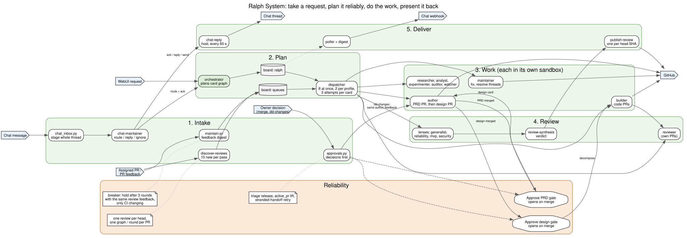
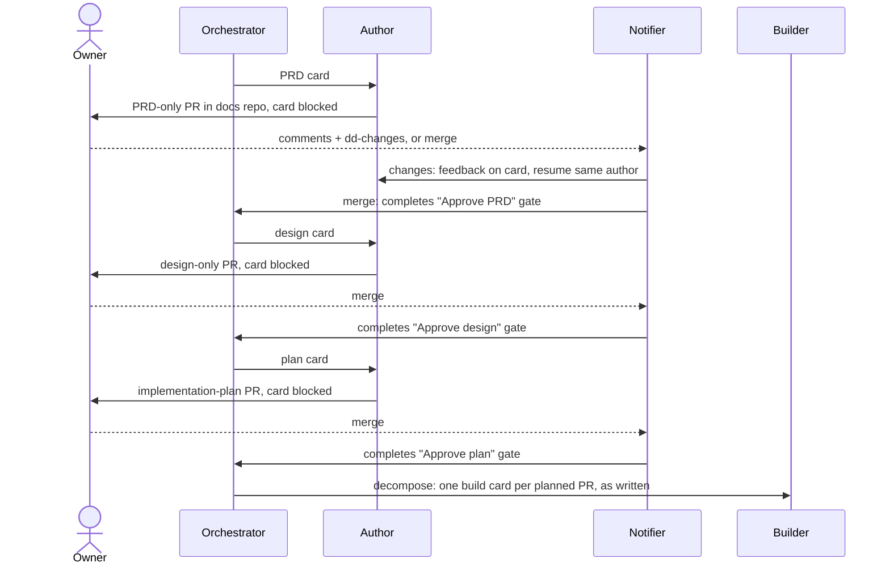
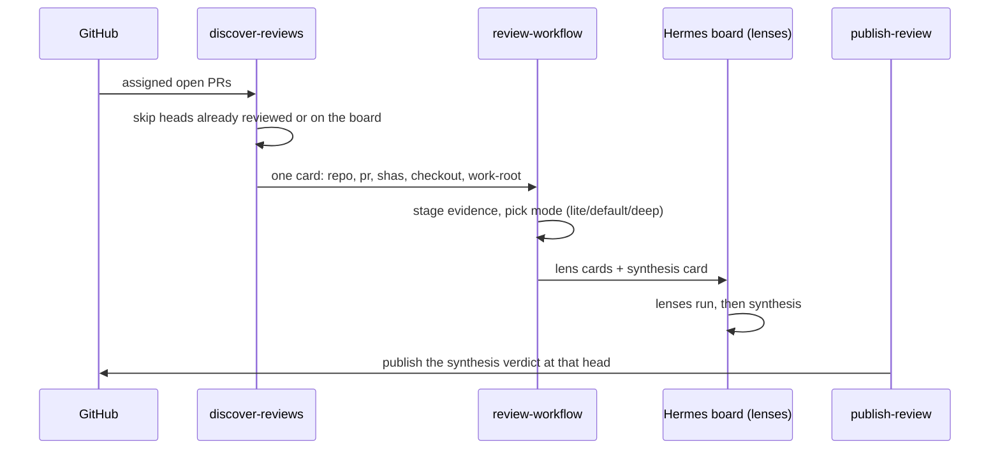
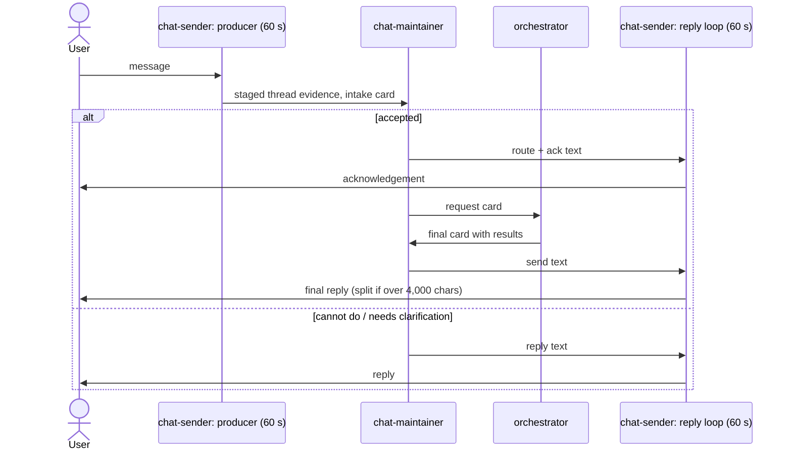

# Workflows

Each workflow: entry, exit, owners, and how it fails. Where the parts run is in [infrastructure.md](infrastructure.md).

## Feature: PRD → design → plan → build

**Entry:** a request to the orchestrator (WebUI, Chat, or a card on `ralph`). **Exit:** merged code PRs. **Owners:** orchestrator (plans), author (documents), reviewer (agent review), builder (code), owner (approval gates).

- The author grounds the PRD in current code, tools and decisions first. PRD, design and implementation plan are separate pull requests.
- The plan lists each PR: goal, design section, `<planned_files>`, dependencies, size under 400 lines, test plan, and the build order. Decompose copies it onto build cards without re-splitting.
- `Approve PRD:`, `Approve design:` and `Approve plan:` cards have no assignee. They open only when the owner **merges** the document PR; an agent review or an open approval does not.
- The notifier enumerates active boards for approval gates, alerts and the daily digest. It keeps separate sent-once state per board; if enumeration fails, it uses a cached board list or skips the whole pass rather than guessing.
- `dd-changes` on a document PR returns it to the same author with the feedback; the label is removed once acted on.
- Before planning or writing, agents search the knowledge index for prior PRDs, designs, decisions and memories, and cite what they used (see [Knowledge](#knowledge-search-and-memories)).

**Failure modes:**
- *A gate card is parked in Hermes `triage`* after a repeated block: the notifier releases it (only cards parked for that reason).
- *Handoff interrupted:* the next poll redoes it.
- *Hermes `active_pr` guard:* the notifier unassigns and reassigns the author so the guard lifts.
- *An old review on a previous commit:* never counts as a decision.

## PR review

**Entry:** a PR in an allowlisted repo assigned to the review account. **Exit:** one review posted per head commit. **Owners:** `discover-reviews` (discovery, handoff), review-workflow (staging, mode, the lens and synthesis graph), lenses, review-synthesis, `publish-review` (the GitHub write).

- New review graphs are created and published on `lenses`. Older graphs stay on `queues` (display name **Intake**); drain and publish them before cutting over. No cards move between boards.
- One review per head SHA, no round cap; one review graph per PR at a time.
- The per-pass cap (10) counts only new handoffs. Published or finally refused cards are recorded and not re-checked.
- review-workflow picks its own mode from the diff -- `discover-reviews` only discovers and hands off, it never decides how deep a review goes.
- Lenses and synthesis read only the staged evidence (`/workspaces/review-work`, read-only).
- No tracker item: review runs in the hundreds, and each already has its own visible record, the PR itself.

**Failure modes:**
- *Discovery misses a just-opened PR:* GitHub search lag. The next pass finds it; `run-review-loop --once` forces one.
- *Card fails on a restart:* each card has 3 attempts.
- *review-workflow's own handoff card fails or is dropped:* `discover-reviews`'s own idempotency key (`<op_id>-intake`) makes re-sending it on the next pass a no-op if it already landed, a real retry if it did not.

## PR maintenance

**Entry:** feedback on a PR authored by `RALPH_MAINTAIN_LOGIN`. **Exit:** pushed fix with threads resolved, or a hold for the owner. **Owner:** maintainer.

- New maintenance cards are created on `maintain`; older rounds remain on `queues` and are not moved. Drain old rounds before cutting over.
- Feedback is a `CHANGES_REQUESTED` review, an unresolved thread (human or bot), or a failing check at the current head. A COMMENTED summary alone is not feedback.
- One round per PR at a time. The maintainer pushes, replies in and resolves each thread it fixed, and posts one summary only if it pushed.
- **Circuit breaker:** after 3 rounds with the same review feedback and only CI changing, the next round is held (blocked) and one Chat alert goes out.

**Failure modes:**
- *CI it cannot see:* builder and maintainer have a Buildkite token where configured.
- *Agent-instruction files:* edits are allowed only where `RALPH_ALLOW_AGENT_FILE_EDITS=1`.

## Chat loop

**Entry:** a message in an allowed Chat space. **Exit:** an acknowledgement and a final reply in the same thread, or one reply. **Owners:** the `chat-sender` sidecar (intake producer, then the reply loop), chat-maintainer, orchestrator, `tracker-sync` (the step between the acknowledgement and the reply: records the item before the acknowledgement, settles pending or closed items once per scan before any reply goes out).

- Chat intake stays on `queues` (display name **Intake**), while routed work stays on `ralph`; the board distinguishes the acknowledgement from the final reply. Email intake also stays on `queues`.
- The destination always comes from the staged intake, never from model text. Ralph's own messages carry a `client-ralph-*` id and are skipped at intake.
- Both halves run as one compose service (`chat-sender`, `COMPOSE_PROFILES=chat`), the Chat token in its own volume the agent's container never mounts (dd-chat.md Sec4.1, D5). Before the owner's cutover (`docs/operations.md`), the overlay `chat_inbox.py` cron job and the host LaunchAgent `chat-reply` do the same two jobs instead.
- Builder card workers can call `list_spaces` through a fixed read-only sidecar command to resolve space IDs; they cannot read messages or send Chat through this tool. A missing sidecar or token returns an error, not an empty list.

**Failure mode:** *no reply arrives.* Check `docker logs <instance>-chat-sender-1` for refusals (or, before the cutover, the LaunchAgent log `~/Library/Logs/ralph-chat-reply-<instance>.err.log`).

## Daily Chat digest

The overlay job `work-chat-digest` (Hermes cron, weekdays 08:30 New York) summarizes Chat and posts to the webhook, split into several messages if long. State prevents a second send the same day.

## Sandbox cleanup

`bootstrap/cleanup-sandboxes`, run by review-loop at most hourly:
- Deletes a card checkout (`workspace/t_<id>`) once its card is done or archived and it has been idle an hour.
- Deletes other workspace folders idle a day, only when the profile has no card in flight.
- Deletes WebUI chat uploads (`.webui-attachments/<session>`) idle a week.
- Clears package caches when a profile's sandbox home passes 5 GB.
- If any board cannot be read, it deletes nothing.

## Knowledge: search and memories

**Entry:** any card or WebUI chat on a profile with the knowledge tools. **Exit:** an answer that cites documents, and maybe one memory note. **Owners:** the knowledge service, `refresh-knowledge`, every searching profile.

- **Search:** `query` with typed searches (`lex` keywords, `vec` meaning) and `rerank: false` over `docs` and `ralph`, about a second; `get` / `multi_get` read a hit in full. Re-ranking is the exception (minutes on CPU). A plain-text `query` is never used: it runs query expansion.
- **Write:** at completion, a lasting finding becomes one file, `memory/<kind>/<date>-<slug>-<card>.md`, written with a single `gh api -X PUT contents` on the docs repo's default branch. With `RALPH_DOCS_PUBLIC=1`, a note that would name people, employers, spaces, private repositories, message content or secrets is not written; the completion says why.
- **Refresh:** review-loop runs `refresh-knowledge` at most hourly. It fast-forwards the checkout, runs `qmd update` and `qmd embed`, and writes `status.json`. A new memory is searchable within the hour.

**Failure modes:**
- *Fetch, update or embed fails:* the previous index keeps answering; `status.json` records the error, and the next hour retries.
- *The docs repo requires PRs on its default branch:* the memory write gets 409 and the card blocks with the reason.
- *Service off or down:* profiles fall back to reading the docs repo through `gh`.

## Librarian

**Entry:** a card the review loop creates once a week on `queues` (**Intake**), assigned to `ralph-librarian`. **Exit:** a pull request on the docs repo reporting one pass, or a card completed with nothing to report. **Owners:** the weekly-card block in `run-review-loop`, `ralph-librarian`.

- One pass, from a fresh checkout that is truth for every decision; the knowledge index only proposes candidates, because it can run up to an hour behind.
- Promotes a document from `in review` to `approved` once its newest `prs:` entry has merged and none is still open (`draft` is never promoted). Fills the memory front matter it can derive (`kind` from the folder, `date` and `source` from the file name or first commit, `profile` from that commit's author when it maps to a `ralph-*` profile) and nothing else; what it cannot derive goes in the pull request body. Merges duplicate notes and marks superseded ones, only when a pair passes three gates (same `kind`, a shared concrete anchor, one sentence true of both with no "and"), at most five of each per run. Archives a `projects/` folder only when every document in it is `approved` or `superseded` and every issue those documents name is closed (a folder whose documents name no issue is never archived, and is listed in the pull request body instead). Rewrites path links to anything moved, and regenerates folder indexes, leaving the repository's root `README.md` and any `README.md` that carries an `id` or `status` alone.
- One commit per requirement group, then one pull request — or none, if the pass changed nothing.

**Failure modes:**
- *Two runs would overlap:* an open pull request with a `librarian/` head, or a librarian card that is neither done nor archived, skips the weekly card; the run checks the pull request again for itself. A guard that cannot be read skips the poll and the next one retries. The card's per-week idempotency key stops a repeat poll creating a second card, but it is not an atomic lock, so two loops polling in the same instant can rarely both create one; the run's own pull-request check (step 1) is the second line.
- *A cap bites:* merged pairs, supersede marks, or changed lines. The run stops between steps, never inside one, lists what it deferred in the pull request body, and next week's run picks it up.
- *Nothing to change:* an empty diff opens no pull request; the card completes saying so.
