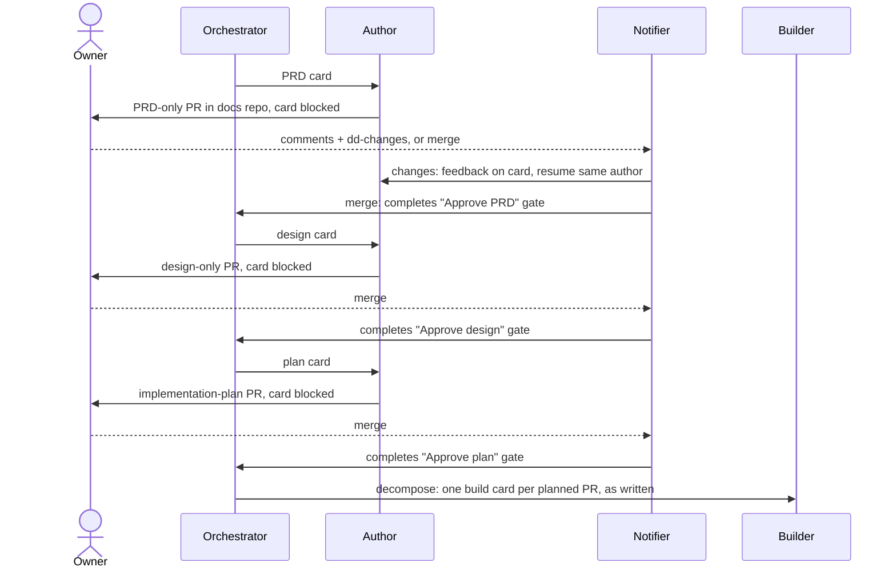
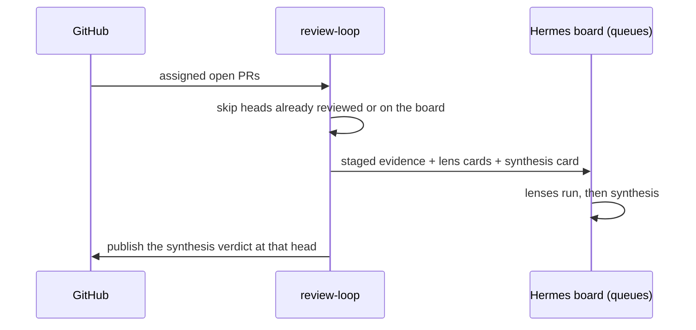
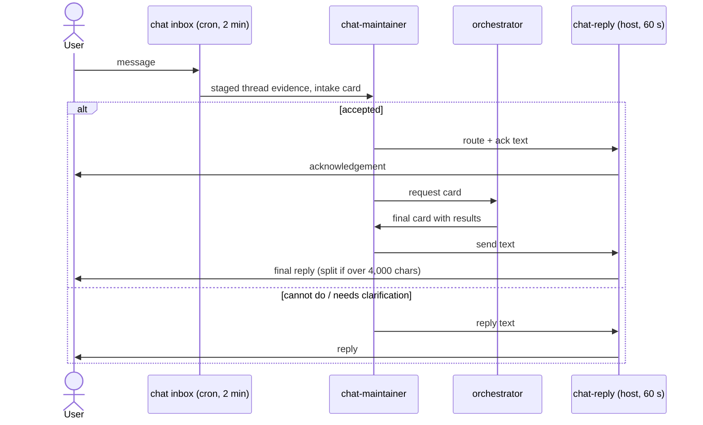

# Workflows

Each workflow: entry, exit, owners, and how it fails. Where the parts run is in [infrastructure.md](infrastructure.md).

## Feature: PRD → design → plan → build

**Entry:** a request to the orchestrator (WebUI, Chat, or a card on `ralph`). **Exit:** merged code PRs. **Owners:** orchestrator (plans), author (documents), reviewer (agent review), builder (code), owner (approval gates).

- The author grounds the PRD in current code, tools and decisions first. PRD, design and implementation plan are separate pull requests.
- The plan lists each PR: goal, design section, `<planned_files>`, dependencies, size under 400 lines, test plan, and the build order. Decompose copies it onto build cards without re-splitting.
- `Approve PRD:`, `Approve design:` and `Approve plan:` cards have no assignee. They open only when the owner **merges** the document PR; an agent review or an open approval does not.
- `dd-changes` on a document PR returns it to the same author with the feedback; the label is removed once acted on.
- Before planning or writing, agents search the knowledge index for prior PRDs, designs, decisions and memories, and cite what they used (see [Knowledge](#knowledge-search-and-memories)).

**Failure modes:**
- *A gate card is parked in Hermes `triage`* after a repeated block: the notifier releases it (only cards parked for that reason).
- *Handoff interrupted:* the next poll redoes it.
- *Hermes `active_pr` guard:* the notifier unassigns and reassigns the author so the guard lifts.
- *An old review on a previous commit:* never counts as a decision.

## PR review

**Entry:** a PR in an allowlisted repo assigned to the review account. **Exit:** one review posted per head commit. **Owners:** review-loop (discovery, publish), lenses, review-synthesis.

- One review per head SHA, no round cap; one review graph per PR at a time.
- The per-pass cap (10) counts only new graphs. Published or finally refused cards are recorded and not re-checked.
- Lenses and synthesis read only the staged evidence (`/workspaces/review-work`, read-only).

**Failure modes:**
- *Discovery misses a just-opened PR:* GitHub search lag. The next pass finds it; `run-review-loop --once` forces one.
- *Card fails on a restart:* each card has 3 attempts.

## PR maintenance

**Entry:** feedback on a PR authored by `RALPH_MAINTAIN_LOGIN`. **Exit:** pushed fix with threads resolved, or a hold for the owner. **Owner:** maintainer.

- Feedback is a `CHANGES_REQUESTED` review, an unresolved thread (human or bot), or a failing check at the current head. A COMMENTED summary alone is not feedback.
- One round per PR at a time. The maintainer pushes, replies in and resolves each thread it fixed, and posts one summary only if it pushed.
- **Circuit breaker:** after 3 rounds with the same review feedback and only CI changing, the next round is held (blocked) and one Chat alert goes out.

**Failure modes:**
- *CI it cannot see:* builder and maintainer have a Buildkite token where configured.
- *Agent-instruction files:* edits are allowed only where `RALPH_ALLOW_AGENT_FILE_EDITS=1`.

## Chat loop

**Entry:** a message in an allowed Chat space. **Exit:** an acknowledgement and a final reply in the same thread, or one reply. **Owners:** overlay `chat_inbox.py` (intake), chat-maintainer, orchestrator, host `chat-reply`.

- The destination always comes from the staged intake, never from model text. Ralph's own messages carry a `client-ralph-*` id and are skipped at intake.

**Failure mode:** *no reply arrives.* Check the LaunchAgent log `~/Library/Logs/ralph-chat-reply-<instance>.err.log` for refusals.

## Daily Chat digest

The overlay job `work-chat-digest` (Hermes cron, weekdays 08:30 New York) summarizes Chat and posts to the webhook, split into several messages if long. State prevents a second send the same day.

## Sandbox cleanup

`bootstrap/cleanup-sandboxes`, run by review-loop at most hourly:
- Deletes a card checkout (`workspace/t_<id>`) once its card is done or archived and it has been idle an hour.
- Deletes other workspace folders idle a day, only when the profile has no card in flight.
- Deletes WebUI chat uploads (`.webui-attachments/<session>`) idle a week.
- Clears package caches when a profile's sandbox home passes 5 GB.
- If any board cannot be read, it deletes nothing.

## Knowledge: search and memories

**Entry:** any card or WebUI chat on a profile with the knowledge tools. **Exit:** an answer that cites documents, and maybe one memory note. **Owners:** the knowledge service, `refresh-knowledge`, every searching profile.

- **Search:** `query` with typed searches (`lex` keywords, `vec` meaning) over `docs` and `ralph`; `get` / `multi_get` read a hit in full. No query expansion runs.
- **Write:** at completion, a lasting finding becomes one file, `memory/<kind>/<date>-<slug>-<card>.md`, written with a single `gh api -X PUT contents` on the docs repo's default branch. With `RALPH_DOCS_PUBLIC=1`, a note that would name people, employers, spaces, private repositories, message content or secrets is not written; the completion says why.
- **Refresh:** review-loop runs `refresh-knowledge` at most hourly. It fast-forwards the checkout, runs `qmd update` and `qmd embed`, and writes `status.json`. A new memory is searchable within the hour.

**Failure modes:**
- *Fetch, update or embed fails:* the previous index keeps answering; `status.json` records the error, and the next hour retries.
- *The docs repo requires PRs on its default branch:* the memory write gets 409 and the card blocks with the reason.
- *Service off or down:* profiles fall back to reading the docs repo through `gh`.
