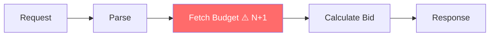
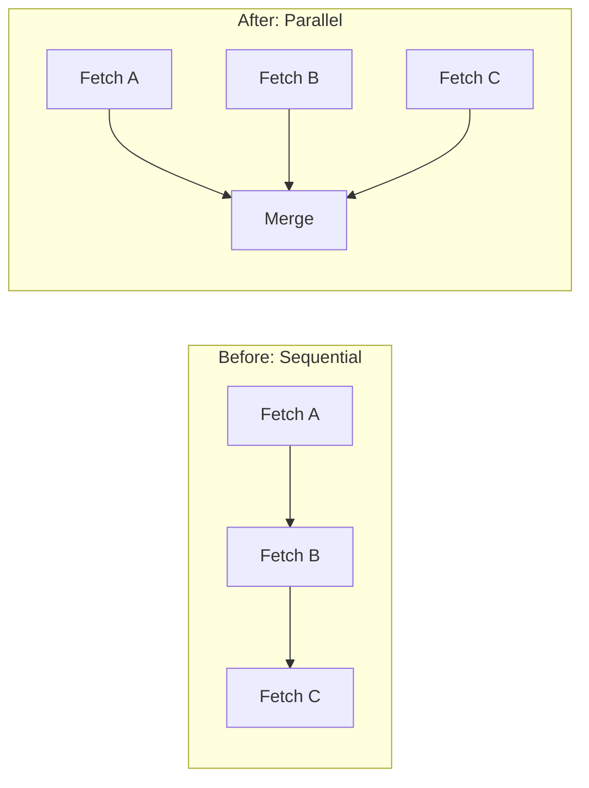

# Optimization Visualization Templates

Mermaid diagram templates for visualizing optimization changes in
code-optimizer reports. Use when optimizations involve data flow changes,
call chains, or architectural restructuring.

## Hot Path Diagram

Show the critical execution path and highlight where bottlenecks occur:

Use `⚠️` annotations to mark bottleneck nodes. Style bottleneck nodes with
`fill:#ff6b6b,color:#fff` (red background).

## Before/After Flow

For structural optimizations, show the change side-by-side:

## When to Include Diagrams

- **Include**: Data flow changes, call chain restructuring, caching layer
  additions, concurrency pattern changes
- **Skip**: Simple variable/algorithm swaps, single-line fixes, naming changes
