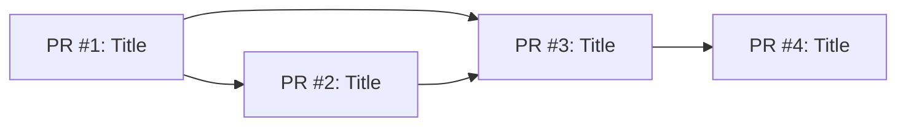

# Implementation Plan: [Feature Name]

## PR Dependency Graph

---

### PR #1: [Title]

- **Goal**: [One sentence summary]
- **Scope**:
  - [ ] [File/component to touch]
  - [ ] [Logic to implement]
- **Dependencies**: [What it blocks / depends on]
- **Testing Strategy**:
  - _Unit_: [What logic needs testing]
  - _Integration_: [What contracts need verification]
- **Observability**:
  - _Metrics_: [Counters/timers to add]
  - _Logs_: [Error/info logs needed]
- **Risk & Mitigation**:
  - _Risk_: [What could break]
  - _Rollback_: [Feature flag disable or revert]
- **Jira**: [Sub-task or link]

---

### PR #2: [Title]

- **Goal**:
- **Scope**:
  - [ ]
- **Dependencies**:
- **Testing Strategy**:
  - _Unit_:
  - _Integration_:
- **Observability**:
  - _Metrics_:
  - _Logs_:
- **Risk & Mitigation**:
  - _Risk_:
  - _Rollback_:
- **Jira**:
