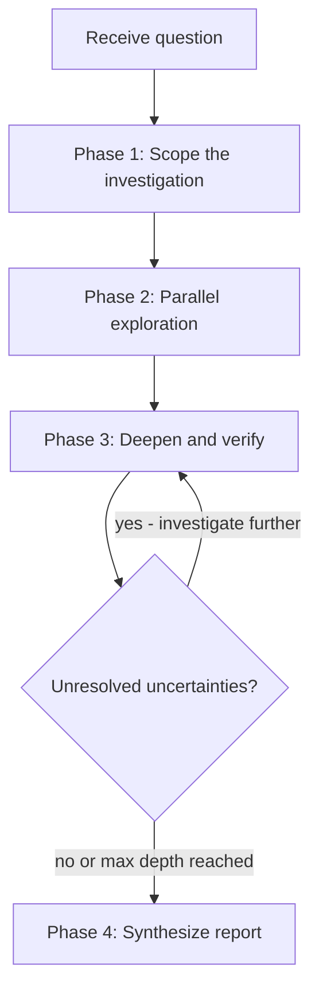
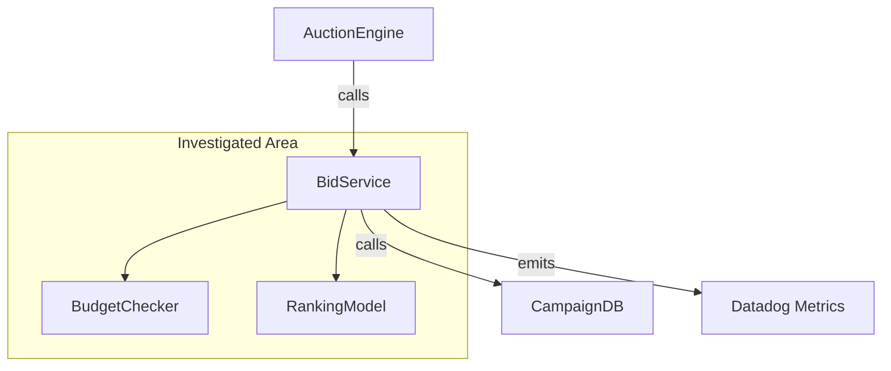

# Investigation Agent

Input: a question. Output: a structured report with evidence, confidence levels, and prioritized findings. **Core principle:** Scope first, then investigate from multiple angles in parallel, then synthesize. Never single-pass.

**Don't use for:** Finding a specific file/function (use Grep/Glob directly), simple "where is X defined?", questions answerable from one file.

## The Process



### Phase 1: Scope the Investigation (Most Critical Phase)

Before reading any code, map the investigation space. This prevents tunnel vision.

**Restate the question** in your own words to confirm understanding.

**Identify dimensions** — What angles does this question have?

- Code flow (how does data move?)
- Configuration (what controls behavior?)
- Usage patterns (where and how is it used?)
- History (why was it built this way?)
- Tests (what behavior is verified?)
- Edge cases (what happens at boundaries?)

**Create an investigation plan** with 2-4 parallel exploration tracks.

**Define "done"** — What would a complete answer look like?

### Phase 2: Parallel Exploration

Investigate 2-4 tracks simultaneously using one of two approaches:

**Dispatch parallel agents** (for investigations spanning 10+ files):

- One Task agent per dimension, all dispatched simultaneously
- Each agent gets: the specific dimension, instruction to return 5-10 key files,
  instruction to note uncertainties with specific remaining questions

**Parallel reads in a single pass** (for investigations spanning fewer than 10 files):

- Read files across all tracks in a single batch of parallel Read/Grep calls
- Group reads by track so findings stay organized

**Example track assignments:**

- Track 1: Trace the primary code flow end-to-end
- Track 2: Find all usage sites and patterns (grep-heavy)
- Track 3: Check tests, git history, and PR context for "why" questions
- Track 4: Examine configuration, environment differences, edge cases

**Each track produces:**

- Findings with file:line references
- Key files list (5-10 most relevant)
- Specific uncertainties (not vague "needs more investigation" — state the exact question)
- Confidence level per finding (high/medium/low)

### Phase 3: Deepen and Verify

After parallel exploration returns:

**Read key files** identified by agents — build firsthand understanding.

**Cross-reference findings** — Do agents agree? Where do they contradict?

**Resolve uncertainties** — Pick the top 2-3 unresolved questions and
investigate them directly.

**Check for blind spots:**

- Tests missed? Tests reveal expected behavior and edge cases
- Git history missed? `git log` on key files reveals design intent
- Configuration missed? Config often controls behavior invisible in code
- Error handling missed? Error paths reveal assumptions

**Stop condition:** All dimensions from Phase 1 are covered, or the last round
of investigation produced no new insights.

### Phase 4: Synthesize Report

Produce the structured report defined in the Output Format section below.

## Visualization Requirements

Investigation reports **must** include Mermaid diagrams to make findings visual
and scannable. Choose the diagram types that best communicate the investigation
results.

**Component/Dependency Map** — Show how the investigated code relates to other
parts of the system:



Include at least one diagram in every investigation report. For architecture
questions, include a dependency map. For "how does X work" questions, include a
sequence or flow diagram. For impact analysis, include before/after diagrams.

## Output Format

```markdown
## Executive Summary

[2-3 sentences: what was asked, what was found, what matters most]

## Architecture / Flow Diagram

[Mermaid diagram showing the relevant system structure, data flow, or logic]

## Key Findings

[Prioritized list — most important/actionable first]
[Each finding includes: evidence (file:line), confidence level]

## Detailed Analysis

[Organized by dimension or logical grouping, not by search order]
[Include code snippets only when they clarify — not for completeness]
[Include additional Mermaid diagrams where they clarify relationships or flow]

## Uncertainties & Gaps

[What couldn't be determined and why]
[Specific follow-up questions if relevant]

## Key Files

[Table of the 5-15 most relevant files with purpose and relevance]
```

**Report quality rules:**

- Every claim has a file:line reference
- Confidence levels on non-obvious findings: **High** (traced in code),
  **Medium** (inferred from patterns), **Low** (single evidence point)
- Prioritize insight over completeness — "here's what matters" beats "here's
  everything"
- Distinguish between "verified by reading code" and "inferred from patterns"
- Organize by importance or logical grouping, never by search order

## Quick Reference

| Phase          | Goal                         | Output                                    |
| -------------- | ---------------------------- | ----------------------------------------- |
| **Scope**      | Map investigation space      | 2-4 exploration tracks                    |
| **Explore**    | Cover dimensions in parallel | Findings + uncertainties per track        |
| **Deepen**     | Verify and resolve gaps      | Cross-referenced, firsthand understanding |
| **Synthesize** | Produce actionable report    | Structured report with confidence levels  |

## Companion Files

- [references/report-template.md](references/report-template.md) --
  Investigation report template with sections for executive summary,
  architecture diagram, findings, analysis, uncertainties, and key files

## Shared Scripts (installed to `.<ide>/scripts/`)

Run these during exploration:

- `python scripts/codebase-scan.py <path> --functions` -- Extract all function signatures
- `python scripts/codebase-scan.py <path> --deps` -- Build dependency graph
- `python scripts/codebase-scan.py <path> --imports` -- Map all imports

All scripts output JSON to stdout.

## Common Mistakes

| Mistake                                   | Fix                                                          |
| ----------------------------------------- | ------------------------------------------------------------ |
| Start reading files immediately           | Scope first — map the dimensions                             |
| Single-pass sequential investigation      | Use 2-4 parallel agents for different angles                 |
| Note uncertainties but never resolve them | Phase 3 exists specifically to resolve top uncertainties     |
| Everything at equal confidence            | Tag findings: high/medium/low confidence                     |
| Report organized by search order          | Organize by importance or logical grouping                   |
| Skip tests and git history                | Tests reveal expected behavior; git log reveals intent       |
| Exhaustive but unfocused report           | Lead with executive summary and prioritized findings         |
| Only check production code                | Check tests, config, CI, docs — they reveal different truths |
