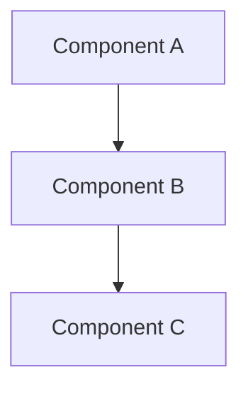

# Investigation Report Template

Use this structure for every investigation output.

## Executive Summary

[2-3 sentences: what was asked, what was found, what matters most]

## Architecture / Flow Diagram

[Choose: dependency map, sequence diagram, or flowchart based on question type]

## Key Findings

[Prioritized list -- most important/actionable first]
[Each finding includes: evidence (file:line), confidence level]

1. **[Finding]** -- [evidence] -- Confidence: **High/Medium/Low**
2. **[Finding]** -- [evidence] -- Confidence: **High/Medium/Low**

## Detailed Analysis

[Organized by dimension or logical grouping, NOT by search order]
[Include code snippets only when they clarify -- not for completeness]
[Include Mermaid diagrams where they clarify relationships or flow]

### [Dimension 1]

### [Dimension 2]

## Uncertainties and Gaps

[What could not be determined and why]
[Specific follow-up questions if relevant]

## Key Files

| File | Purpose | Relevance |
| ---- | ------- | --------- |
|      |         |           |

## Confidence Levels

- **High**: Traced and verified in code
- **Medium**: Inferred from patterns across multiple files
- **Low**: Single evidence point or indirect reference
