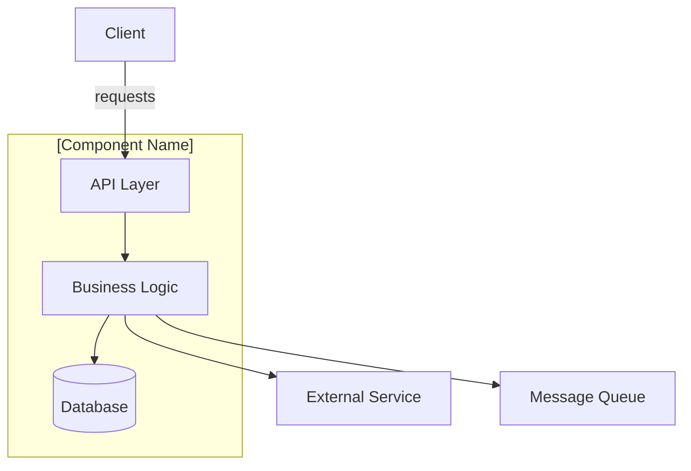
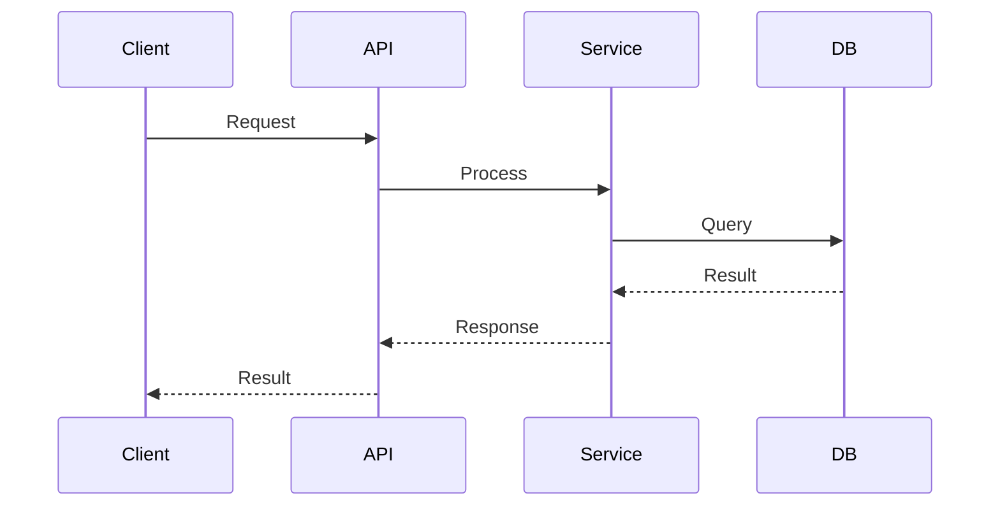

# Architecture: [Component Name]

## Overview

[2-3 sentence description of the component's role in the system.]

## System Diagram

## Dependencies

| Dependency     | Type      | Purpose                          |
| -------------- | --------- | -------------------------------- |
| [Service A]    | Internal  | [What data/function it provides] |
| [Database]     | Datastore | [What data it stores]            |
| [External API] | External  | [What it provides]               |

## API Contracts

### [Endpoint/Interface Name]

- **Method**: GET/POST/gRPC
- **Path**: `/api/v1/resource`
- **Request**: [Schema or reference]
- **Response**: [Schema or reference]
- **SLO**: p95 < [X]ms

## Data Flow

## Key Design Decisions

| Decision     | Rationale                      | Date   |
| ------------ | ------------------------------ | ------ |
| [Decision 1] | [Why this approach was chosen] | [When] |
