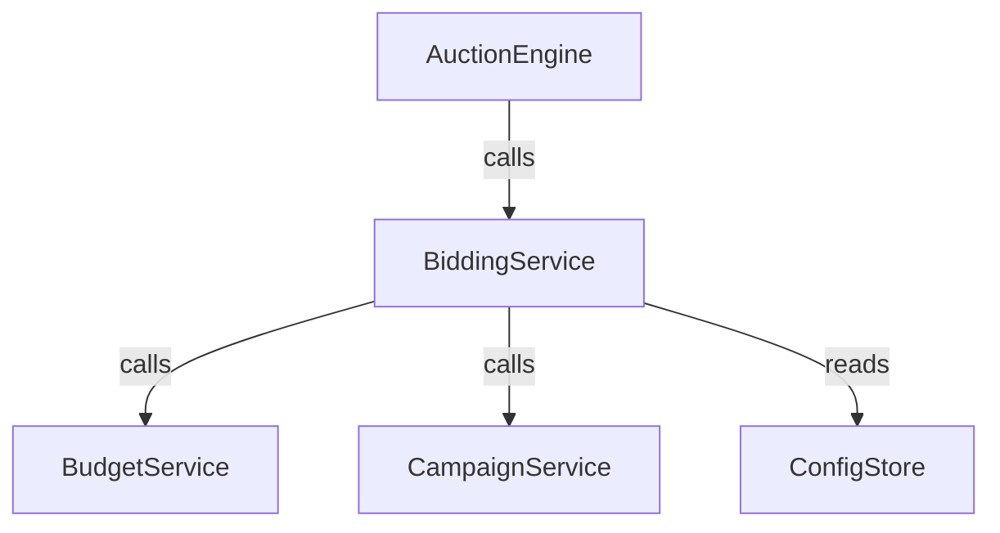
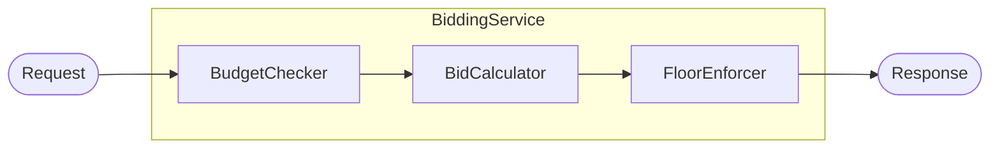
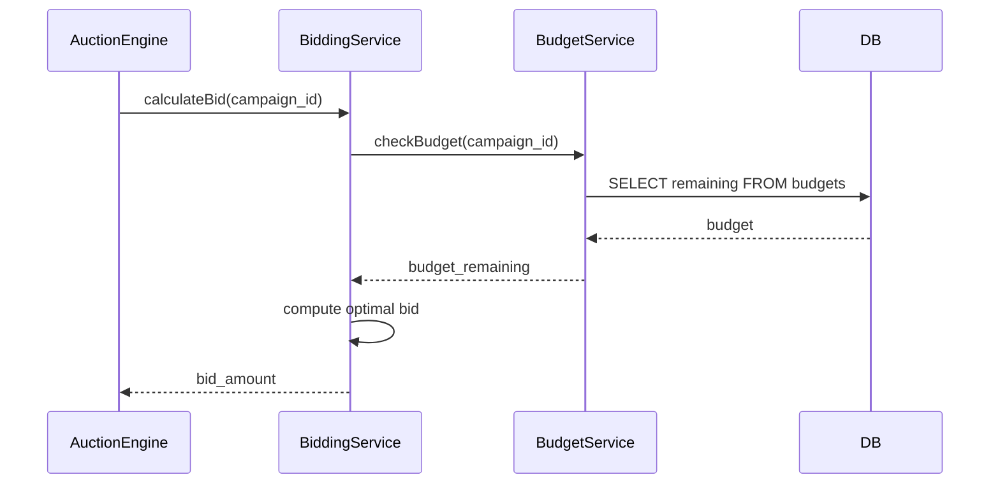
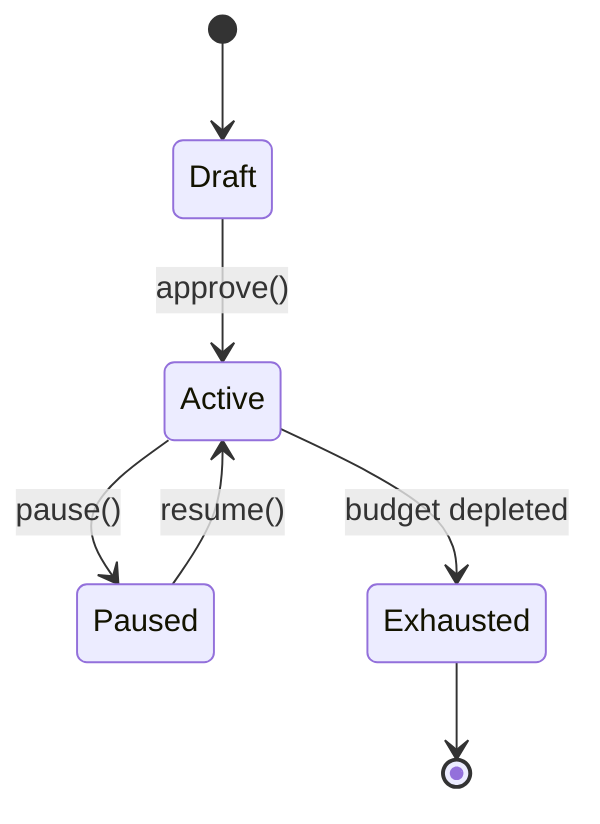

# Mermaid Diagram Patterns for Architecture Docs

Reference companion to `doc-writer/SKILL.md`. Reusable Mermaid diagram
patterns for `/docs/ARCHITECTURE.md` updates. Always include diagrams when
changes affect system architecture — prose alone is insufficient.

## Dependency Diagram

Show what the service calls and what calls it:

````markdown
### Dependencies


````

## Component Diagram

Show internal components and their relationships:

````markdown
### Components



- **BidCalculator**: Core bid computation logic
- **BudgetChecker**: Validates campaign budget availability (NEW)
- **FloorEnforcer**: Ensures bids meet minimum thresholds
````

## Data Flow / Sequence Diagram

Show how a request flows through the system:

````markdown
### Data Flow


````

## State Diagram

For features with lifecycle states:

````markdown
### Campaign Lifecycle


````

## When to Use Which Diagram

| Change Type              | Recommended Diagrams                |
| ------------------------ | ----------------------------------- |
| New service dependency   | Dependency + Sequence               |
| Internal refactor        | Component                           |
| New API endpoint         | Sequence + Dependency               |
| State machine / workflow | State                               |
| Most changes (default)   | Dependency graph + Sequence diagram |

Multiple diagrams are encouraged. A dependency graph plus a sequence diagram
is a strong default for most architecture changes.
